# SƠ ĐỒ MINH HOẠ HỆ THỐNG STOCK LAKEHOUSE AI

> **Tài liệu này toàn hình ảnh / ký hiệu.**
> Mục đích: bạn nhìn là hiểu ngay, không phải đọc 5 trang chữ.
>
> Mỗi sơ đồ có **3 phần**: (①) hình vẽ → (②) đọc hình vẽ bằng lời đời thường → (③) chi tiết kỹ thuật.
> Chi tiết đầy đủ nằm ở [`HE_THONG_TOAN_DIEN_VA_GIAI_TRINH_KHOA_LUAN.md`](./HE_THONG_TOAN_DIEN_VA_GIAI_TRINH_KHOA_LUAN.md).
>
> **Cập nhật 10/11/2026:** Kafka và Iceberg đã bị **gỡ khỏi dự án**. Sơ đồ 1 được
> vẽ lại (khối `Kafka` → khối `SCHEDULER`), và thêm 3 sơ đồ mới: 15 (luồng tin tức),
> 16 (dự báo phiên kế tiếp), 17 (bộ đếm cron).
>
> **Cập nhật 12/11/2026:** toàn bộ **hệ thống tin tức** đã bị gỡ khỏi dự án. Sơ đồ 15
> được vẽ lại thành "đường đi duy nhất của dữ liệu". Lý do và số liệu đo được nêu ở
> mục 5B.1 của `HE_THONG_TOAN_DIEN_VA_GIAI_TRINH_KHOA_LUAN.md`.

---

## MỤC LỤC

| # | Sơ đồ | Xem để hiểu |
|---|---|---|
| [1](#1) | Tổng thể hệ thống — 3 khối | Hệ thống nằm ở đâu, dữ liệu chảy hướng nào |
| [2](#2) | Luồng dữ liệu 3 tầng (Medallion) | Bronze → Silver → Gold |
| [3](#3) | Quy trình train & dự báo | 1 click chạy qua những bước nào |
| [4](#4) | Timeline backtest — tránh nhìn thấy tương lai | Vì sao `shift(1)` là bắt buộc |
| [5](#5) | Walk-forward — 159 cửa sổ trượt | Cách kiểm định ngoài mẫu |
| [6](#6) | Lỗi 3 bug walk-forward | Từ triệu chứng → nguyên nhân → fix |
| [7](#7) | LSTM — dự đoán tỷ lệ thay vì mức giá | Đóng góp kỹ thuật chính |
| [8](#8) | So sánh 3 mô hình | Tại sao báo cả 3 |
| [9](#9) | GIL — tại sao cần Process pool | Vì sao có 2 pool riêng |
| [10](#10) | Request Gate — ưu tiên người dùng | Cách hệ thống không bị nghẽn |
| [11](#11) | TanStack Query — vòng đời dữ liệu | Vì sao đổi mã thì chart phải đổi |
| [12](#12) | Luồng AI Agent | Số trong câu trả lời đến từ đâu |
| [13](#13) | Chống rò rỉ dữ liệu — bức tường | 3 lớp bảo vệ |
| [14](#14) | Bản đồ truy vết đồ án | Yêu cầu → code → bằng chứng |
| [15](#15) | Đường đi duy nhất của dữ liệu sau khi gỡ tin tức | Bronze → Silver → Gold → mô hình → web |
| [16](#16) | Dự báo phiên kế tiếp tự động | Batch EOD → MySQL `predictions` → thẻ trên Dashboard |
| [17](#17) | Bộ đếm cron — đồng hồ báo giờ | Lịch trong file, Docker giám sát, mọi lần chạy đều có log |

---

<a id="1"></a>
## 1. Tổng thể hệ thống — 3 khối

### ① Hình vẽ

```
┌──────────────────────────────────────────────────────────────────────────────┐
│                     TRÌNH DUYỆT  (React + TypeScript)                        │
│                                                                              │
│    ┌────────┐  ┌──────────┐  ┌──────────┐  ┌────────┐  ┌─────────┐           │
│    │Tổng    │  │Dữ liệu  │  │Phân tích │  │DỰ BÁO  │  │BACKTEST │            │
│    │quan    │  │thị       │  │kỹ thuật │  │        │  │         │            │
│    │quan    │  │trường    │  │          │  │        │  │         │           │
│    └────────┘  └──────────┘  └──────────┘  └────────┘  └─────────┘           │
│                                                                              │
│    ┌────────┐  ┌───────────────────────────────────────────────────────────┐ │
│    │AI AGENT│  │   Dữ liệu đi qua đúng 1 đường:  HTTP GET / POST  JSON   │   │
│    └────────┘  └───────────────────────────────────────────────────────────┘ │
└──────────────────────────────────┬─────────────────────────────────────────── ┘
                                   │
                                   ▼
┌──────────────────────────────────────────────────────────────────────────────┐
│                     SERVER BACKEND  (FastAPI + Python)                       │
│                                                                              │
│  ┌────────────────────────────────────────────────────────────────────────┐  │
│  │  LỚP API    ·    13 nhóm endpoint    ·    trả về {success, data, msg} │   │
│  └────────────────────────────────────────────────────────────────────────┘  │
│                                                                              │
│  ┌──────────────┐  ┌──────────────┐  ┌──────────────┐  ┌────────────────┐    │
│  │  DỰ BÁO      │  │  BACKTEST    │  │   AI AGENT   │  │  ĐỌC DỮ LIỆU  │     │
│  │              │  │              │  │              │  │                │    │
│  │ Linear Reg   │  │ MA Crossover │  │  LLM Gemini  │  │ MarketService  │    │
│  │ ARIMA        │  │ RSI Strategy │  │              │  │  LRU 256 mã    │    │
│  │ LSTM         │  │              │  │  16 TOOL     │  │  TTL 900 giây  │    │
│  │              │  │ Walk-Forward │  │              │  │                │    │
│  │ Multi-step   │  │  159 cửa sổ  │  │  Fallback    │  │ Request Gate   │    │
│  └──────────────┘  └──────────────┘  └──────────────┘  └────────────────┘    │
│         │                 │                 │                 │              │
│         └─────────────────┴─────────────────┴─────────────────┘              │
│                                    │                                         │
│  ┌─────────────────────────────────┴──────────────────────────────────────┐  │
│  │  LỚP DỮ LIỆU   ·   Bronze  →  Silver  →  Gold   ·   Pipeline   ·   Re │   │
│  └─────────────────────────────────┬──────────────────────────────────────┘  │
│                                    │                                         │
│  ┌─────────────────────────────────┴──────────────────────────────────────┐  │
│  │  HEAVY WORKER   ·   pool "interactive" = 2   ·   pool "background" = 4 │  │
│  │  (tiến trình con — có GIL riêng — không làm nghẽn server chính)       │   │
│  └────────────────────────────────────────────────────────────────────────┘  │
└──────────────────────────────────┬───────────────────────────────────────────┘
                                   │
        ┌──────────────────────────┼──────────────────────────┐
        ▼                          ▼                          ▼
┌────────────────┐        ┌────────────────┐        ┌────────────────┐
│     MINIO      │        │     MySQL      │        │   SCHEDULER    │
│   (S3 / Object)│        │                │        │  (cron -f)     │
│                │        │  metadata +    │        │                │
│ stock-bronze   │        │  lịch sử       │        │                │
│ stock-silver   │        │                │        │                │
│ stock-gold     │        │ backtest_runs  │        │  job: eod      │
│ stock-models   │        │ model_runs     │        │                │
│ 116.110 file   │        │ predictions    │        │                │
│ 116.482 file   │        │ users          │        │                │
│ 115.100 file   │        │                │        │                │
└────────────────┘        └────────────────┘        └────────────────┘
```

> **Ghi chú 10/11/2026:** khối bên phải trước đây là **Kafka**. Nó đã bị **gỡ khỏi
> dự án** và được thay bằng container **`scheduler`** chạy `cron`. Xem mục 1 của
> [`architecture.md`](./architecture.md) và Phần 5B.5 của tài liệu giải thích.
>
> **Ghi chú 12/11/2026:** hai bucket `stock-bronze-news` và `stock-silver-news` đã bị
> gỡ khỏi MinIO cùng toàn bộ hệ thống tin tức. Lịch cron cũng còn **1 job** (`eod`),
> chạy 2 lần/ngày.

### ② Đọc hình vẽ bằng lời đời thường

Hình trên có **3 khối lớn**:

1. **Trình duyệt** (trên cùng) — nơi bạn bấm nút và nhìn biểu đồ. Nó **không tự tính toán gì**.
2. **Server** (giữa) — nơi mọi tính toán thật xảy ra: dự báo, backtest, đọc dữ liệu.
3. **Nơi lưu** (dưới) — MinIO giữ dữ liệu lớn, MySQL giữ lịch sử.

**Mũi tên đi xuống = dữ liệu chảy vào. Mũi tên đi lên = kết quả chảy về.**

**Điểm quan trọng nhất:** trình duyệt chỉ có **một đường duy nhất** để lấy số liệu — đó là API. Không có đường nào đọc file trực tiếp. Đó là lý do biểu đồ và bảng số liệu không bao giờ mâu thuẫn nhau.

**Hộp "HEAVY WORKER"** là chi tiết đáng chú ý: những việc nặng (walk-forward 159 cửa sổ) không chạy trong server chính mà chạy ở **tiến trình con**, để không làm nghẽn việc bạn bấm nút.

**Khối "SCHEDULER"** ở góc dưới bên phải là chiếc đồng hồ báo giờ của hệ thống. Nó không trả lời trình duyệt; nó **tự làm việc theo lịch**: hai lần một ngày nó cập nhật giá và dự báo phiên kế tiếp. Trước 10/11/2026 chỗ này là Kafka — một hệ thống truyền dữ liệu qua đường ống — và nó đã bị gỡ bỏ. (Trước 12/11/2026 còn có thêm việc thu thập tin tức mỗi 30 phút; việc đó cũng đã bị gỡ.)

### ③ Chi tiết kỹ thuật

- `backend/app/api/v1/endpoints/` — 13 module endpoint
- `backend/app/core/heavy_worker.py` — 2 process pool (`interactive=2`, `background=4`)
- `backend/app/core/request_gate.py` — cổng ưu tiên người dùng
- `backend/app/services/market_service.py` — LRU cache 256 symbol + TTL 900s
- `backend/app/lakehouse/storage_factory.py` — chọn MinIO hoặc filesystem local
- `backend/crontab` — lịch cron (giờ UTC): EOD 21:30 + 03:30
- `backend/scripts/run_scheduled_job.py` — 1 job: `eod`
- `backend/app/database/models/prediction.py` — bảng MySQL `predictions`

---

<a id="2"></a>
## 2. Luồng dữ liệu 3 tầng (Medallion)

### ① Hình vẽ

```
   ═══════════════════════════════════════════════════════════════════
   BƯỚC 1 — LẤY DỮ LIỆU TỪ INTERNET
   ═══════════════════════════════════════════════════════════════════

     yahoo_http ─┐
     yfinance   ─┤
     finnhub    ─┼──►  thử lần lượt ──►  nhà nào trả dữ liệu thật
     alpha_vntg  ─┤                       thì dùng nhà đó
     web_scraper ─┤
     ssi_vn      ─┘  (chỉ cứu mã HOSE/HNX/UPCoM)

     ! circuit breaker:
        lỗi HẠN MỪNG (hết quota) ──► TẠM NGƯNG provider 15 phút
        lỗi DỮ LIỆU  (404 1 mã)   ──► KHÔNG tính, provider vẫn tốt


   ═══════════════════════════════════════════════════════════════════
   BƯỚC 2 — 3 TẦNG LƯU TRỮ (MinIO)
   ═══════════════════════════════════════════════════════════════════

   ┌───────────────────────────────────────────────────────────────────┐
   │     BRONZE   bucket "stock-bronze"                                │
   │                                                                   │
   │    symbol=AAPL/year=2016/month=10/part-0.parquet                  │
   │    symbol=AAPL/year=2016/month=11/part-0.parquet                  │
   │    ...                                                            │
   │    symbol=AAPL/_lineage.json   ← nguồn + thời điểm + số bản ghi   │
   │                                                                   │
   │       GIỮ NGUYÊN, chỉ thêm không sửa                              │
   │    116.110 file                                                   │
   └───────────────────────────────┬───────────────────────────────────┘
                                   │  làm sạch
                                   ▼
   ┌───────────────────────────────────────────────────────────────────┐
   │     SILVER   bucket "stock-silver"                                │
   │                                                                   │
   │    · bỏ bản trùng (dedupe)                                        │
   │    · kiểm tra OHLC hợp lệ                                         │
   │    · chuẩn hoá múi giờ → UTC                                      │
   │    · canonicalize phiên giao dịch                                 │
   │    · kiểm tra giá hợp lý (plausibility)                           │
   │                                                                   │
   │    symbol=AAPL/_quality.json  ← ĐẾM ĐÃ LOẠI BAO NHIÊU + LÝ DO     │
   │                                                                   │
   │       ĐÃ RỬA, có báo cáo rác                                      │
   │    116.482 file                                                   │
   └───────────────────────────────┬───────────────────────────────────┘
                                   │  tính chỉ báo + gắn nhãn
                                   ▼
   ┌───────────────────────────────────────────────────────────────────┐
   │     GOLD   bucket "stock-gold"                                    │
   │                                                                   │
   │    12 cột gốc  (OHLCV, volume, source, ingestion_time, year, …)   │
   │  + 75 features (SMA, EMA, RSI, MACD, Bollinger, regime, nến, …)   │
   │  + 3 targets  (target_close_next, target_return_next, …)          │
   │  ─────────────────────────────────────────────────────────────    │
   │  = 90 cột                                                         │
   │                                                                   │
   │       ĐÃ NẤU, có nhãn đáp án                                      │
   │    115.100 file                                                   │
   └───────────────────────────────┬───────────────────────────────────┘
                                   │
                                   ▼
                    MÔ HÌNH ML  ·  BACKTEST  ·  BIỂU ĐỒ WEB


   ═══════════════════════════════════════════════════════════════════
   VÌ SAO 3 TẦNG?  (vì sao không gộp làm một)
   ═══════════════════════════════════════════════════════════════════

   ┌─────────────────┐     ┌─────────────────┐     ┌─────────────────┐
   │      BRONZE     │     │      SILVER     │     │       GOLD      │
   │                 │     │                 │     │                 │
   │     GIỮ NGUYÊN  │     │     ĐÃ RỬA     │     │     ĐÃ NẤU       │
   │                 │     │                 │     │                 │
   │ như vừa tải    │     │ sạch + chuẩn   │     │ chỉ báo + nhãn    │
   │ về, KHÔNG sửa  │     │ hoá + đếm rác  │     │ sẵn cho mô hình   │
   │                 │     │                 │     │                 │
   │  DÙNG ĐỂ:      │     │  DÙNG ĐỂ:      │     │  DÙNG ĐỂ:         │
   │  phòng khi cần │     │  tính toán,    │     │  đưa vào mô       │
   │  làm lại từ    │     │  kiểm tra      │     │  hình ML          │
   │  đầu           │     │                 │     │                  │
   │                 │     │                 │     │                 │
   │   bất biến     │     │  có báo cáo    │     │  có nhãn đáp án   │
   └─────────────────┘     └─────────────────┘     └─────────────────┘
```

### ② Đọc hình vẽ bằng lời đời thường

Giống bếp nhà hàng:
- **Bronze** = hàng thô vừa nhập về, chưa rửa. Giữ nguyên để phòng khi cần làm lại.
- **Silver** = đã rửa sạch, cắt bỏ rác, đếm được đã bỏ bao nhiêu.
- **Gold** = đã nấu thành món, gắn nhãn sẵn để đưa thẳng vào mô hình.

**Điểm cốt lõi:** Bronze **không bao giờ bị sửa**. Nếu thuật toán tính chỉ báo sai, bạn chỉ cần chạy lại Silver + Gold từ Bronze — không phải tải lại từ Internet.

**Circuit breaker** giải thích một chi tiết tinh vi: nếu mã "MCD" bị 404 (cổ phiếu đã bị hủy niêm yết), đó là **lỗi của mã**, không phải lỗi của Yahoo. Nếu không tách, một mã 404 sẽ vô hiệu hoá một nhà cung cấp hoàn toàn khoẻ.

### ③ Chi tiết kỹ thuật

- Bronze: `backend/app/lakehouse/bronze.py` — schema 12 cột, append-only, idempotent
- Silver: `backend/app/lakehouse/silver.py` — ghi `_quality.json` (đếm rác + lý do)
- Gold: `backend/app/lakehouse/gold.py` — strip về 12 cột gốc trước khi enrich (idempotent)
- Quy mô đo ngày 06/11/2026: Bronze 116.110 · Silver 116.482 · Gold 115.100 partition

---

<a id="3"></a>
## 3. Quy trình train & dự báo

### ① Hình vẽ

```
[BẠN BẤM NÚT "Train và Dự báo" ở trang /forecast — tab "Huấn luyện & so sánh model"]
    │
    ▼
┌────────────────────────────────────────────────────────────────────────┐
│  BƯỚC 1 — NẠP DỮ LIỆU                                                  │
│                                                                        │
│    GoldLayer().read("AAPL")                                            │
│         │                                                              │
│         ├── đọc ~121 file parquet từ MinIO (mỗi file = 1 tháng)        │
│         ├── đọc theo thứ tự thời gian: 2016 ────────────────► 2026     │
│         └── kết quả: DataFrame 2.500 hàng × 90 cột                     │
└────────────────────────────────────────────────────────────────────────┘
    │
    ▼
┌────────────────────────────────────────────────────────────────────────┐
│  BƯỚC 2 — CHUẨN BỊ                                                     │
│                                                                        │
│    drop hàng có target  NaN   (dòng cuối không có "đáp án")            │
│    drop hàng có feature NaN   (chưa đủ 50 phiên cho SMA50)             │
│                                                                        │
│    set_global_seed(42)   ← để kết quả lặp lại được                     │
└────────────────────────────────────────────────────────────────────────┘
    │
    ▼
┌────────────────────────────────────────────────────────────────────────┐
│  BƯỚC 3 — CHIA THEO THỜI GIAN  (KHÔNG XÁO TRỘN!)                       │
│                                                                        │
│    ┌────────────────────┬──────────────────┬─────────────────────┐     │
│    │    TRAIN  70%      │ VALIDATION  15%  │     TEST  15%      │      │
│    │                    │                  │                     │     │
│    │  2016 ────────────►│──────────────►   │──────────────► 2026 │     │
│    │                    │                  │                     │     │
│    │  mô hình HỌC      │  DỪNG SỚM       │  ĐO 1 LẦN DUY NHẤT │        │
│    │  ở đây            │  (early stop)    │  giấu kín           │      │
│    │                    │                  │                     │     │
│    │  1.750 phiên      │  375 phiên       │  375 phiên          │      │
│    └────────────────────┴──────────────────┴─────────────────────┘     │
│                                                                        │
│    ! KHÔNG BAO GIỜ dùng train_test_split (xáo trộn ngẫu nhiên)         │
└────────────────────────────────────────────────────────────────────────┘
    │
    ├──────────────────┬──────────────────┬───────────────┐
    ▼                  ▼                  ▼               │
┌─────────┐      ┌─────────┐      ┌─────────┐               │
│ Linear  │      │  ARIMA  │      │  LSTM   │               │
│ Reg.    │      │ (5,1,0) │      │ 2 lớp   │               │
│ 21 feat │      │ không  │      │ 64 hid  │                │
│         │      │ feature │      │ seq 60  │               │
└────┬────┘      └────┬────┘      └────┬────┘               │
     │                 │                   │                │
     └─────────────────┴───────────────────┘                │
                       │                                    │
                       ▼                                    │
┌────────────────────────────────────────────────────────────────────────┐
│  BƯỚC 5 — ĐO TRÊN TẬP TEST (15%)                                       │
│                                                                        │
│    MAE  ·  RMSE  ·  MAPE  ·  ĐÚNG HƯỚNG (DA)                           │
└────────────────────────────────────────────────────────────────────────┘
    │
    ▼
┌────────────────────────────────────────────────────────────────────────┐
│  BƯỚC 6 — LƯU                                                          │
│                                                                        │
│    MinIO: stock-models/AAPL/<model>/                                   │
│              metadata.json · scalers · model · predictions.parquet     │
│    MySQL : model_runs                                                  │
└────────────────────────────────────────────────────────────────────────┘
    │
    ▼
┌────────────────────────────────────────────────────────────────────────┐
│  BƯỚC 7 — DỰ BÁO ĐA BƯỚC ĐỆ QUY  (nếu bạn bấm "Dự báo")                │
│                                                                        │
│    với mỗi bước h:                                                     │
│       dự đoán close[t+h] từ feature của t+h-1                          │
│            │                                                           │
│            ├── ghi giá dự đoán vào hàng feature của t+h                │
│            │                                                           │
│            ├── TÍNH LẠI chỉ báo phụ thuộc (SMA, RSI, Bollinger…)       │
│            │                                                           │
│            └── lặp lại h lần                                           │
│                                                                        │
│    ! Sai số TÍCH LUỸ mỗi bước — đây là điểm thành thật, không che      │
└────────────────────────────────────────────────────────────────────────┘
```

### ② Đọc hình vẽ bằng lời đời thường

Hình này cho thấy **1 cú click chạy qua 7 bước**.

Điều đáng chú ý nhất là **Bước 3**: dữ liệu bị chia thành 3 khúc theo **thứ tự thời gian**, không phải ngẫu nhiên. Hình dung: bạn cho học sinh luyện bằng đề **có sẵn đáp án** (train), rồi dùng đề luyện khác để canh nhịp (validation), và **một đề thi thật giấu kín** để đo lần cuối (test).

Nếu chia ngẫu nhiên, dữ liệu tháng 12/2026 có thể nằm trong tập train, còn tháng 1/2016 nằm trong tập test → mô hình học "từ tương lai đoán quá khứ" → điểm cao nhưng vô nghĩa.

### ③ Chi tiết kỹ thuật

- `backend/app/forecasting/trainer.py` — `train_model()`
- `backend/app/forecasting/preprocessing.py` — `chronological_split()`
- `backend/app/forecasting/lstm.py` — `_fit_targets` (chỉ train) vs `_transform_targets` (validation)
- `backend/app/forecasting/evaluator.py` — 4 bộ chỉ số
- `backend/app/forecasting/multistep.py` — đệ quy + `_prediction_offset()`
- Kết quả đo ngày 06/11/2026 (AAPL): LR MAE 2.994 · ARIMA 3.006 · LSTM 3.294

---

<a id="4"></a>
## 4. Timeline backtest — tránh nhìn thấy tương lai

### ① Hình vẽ

```
GIÁ ĐÓNG CỬA (đã biết)
    │
─────┼─────┬─────┬─────┬─────┬─────┬─────     ┬─────►  thời gian
    │     │     │     │     │     │     │     │
  Ngày   Ngày   Ngày   Ngày   Ngày   Ngày   Ngày
    1     2     3     4     5     6     7
    │     │     │     │     │     │     │     │
    ▼     ▼     ▼     ▼     ▼     ▼     ▼     ▼
┌──────────────────────────────────────────────────┐
│  TÍN HIỆU  (sinh ra khi bar t đã đóng)           │
│  signal[t] = +1 (mua)  hoặc  -1 (bán)            │
└──────────────────────────────────────────────────┘
    │
    │  ══════ shift(1) ══════  ▼ lệch 1 hàng xuống
    ▼     ▼     ▼     ▼     ▼     ▼
┌──────────────────────────────────────────────────┐
│  THỰC THI  (lệnh khớp ở bar KẾ TIẾP)             │
│  execution_signal[t] = signal[t-1]               │
└──────────────────────────────────────────────────┘
    │     │     │     │     │     │     │
    ▼     ▼     ▼     ▼     ▼     ▼     ▼
┌──────────────────────────────────────────────────┐
│  KHỚP LỆNH + TÍNH TIỀN                           │
│  giá khớp = open của bar kế tiếp                 │
│  + phí 0.1%  + trượt giá 0.05%                   │
│  → cập nhật tiền mặt + cổ phiếu                  │
└──────────────────────────────────────────────────┘
    │
    ▼
┌──────────────────────────────────────────────────┐
│  MARK-TO-MARKET mỗi phiên                        │
│  equity[t] = tiền mặt + cổ phiếu × close[t]      │
│  → vẽ thành ĐƯỜNG VỐN TÀI SẢN (equity curve)     │
└──────────────────────────────────────────────────┘


!! NẾU THẾT BẠI BỎ shift(1) — LỖI LOOK-AHEAD BIAS
══════════════════════════════════════════════════════════════════

  Giả sử giá Ngày 1 thấp, giá Ngày 2 cao.

  SAI:
     dùng close[1] để quyết định "mua", rồi khớp lệnh
     vào CHÍNH close[1].
     → bạn ĐÃ BIẾT Ngày 1 tăng hay giảm TRƯỚC khi quyết định
     → kết quả đẹp đẽ và VÔ NGHĨA

  ĐÚNG:
     dùng close[1] để quyết định, rồi khớp lệnh vào
     open của Ngày 2.
     → bạn KHÔNG THỂ biết giá Ngày 2 lúc ra quyết định
     → đây mới là backtest trung thực
```

### ② Đọc hình vẽ bằng lời đời thường

Đây là **quy tắc quan trọng nhất** của toàn bộ hệ thống backtest.

Tín hiệu "mua" được sinh ra lúc **15:00 ngày 1** (khi bar ngày 1 đóng cửa). Lệnh thực tế khớp vào **9:30 ngày 2** (giá mở cửa). Ngày 1, bạn **không hề biết** ngày 2 sẽ đi lên hay xuống.

Nếu hệ thống lấy giá đóng cửa ngày 1 để quyết định rồi khớp lệnh vào **chính giá đóng cửa ngày 1**, thì nó đã "biết trước" kết quả → backtest trở thành một trò may mắn, không phải khoa học.

### ③ Chi tiết kỹ thuật

```python
# backend/app/backtesting/engine.py
signals = strategy.generate_signals(frame)
execution_signal = signals.shift(1).fillna(0)   # ← dòng then chốt
```

`simulate()` khớp lệnh ở **open** bar, fallback **close** nếu open là NaN.

---

<a id="5"></a>
## 5. Walk-forward — 159 cửa sổ trượt

### ① Hình vẽ

```
LỊCH SỬ GIÁ AAPL 2016 ────────────────────────────────────► 2026

CỬA SỔ 0    [████ HỌC 180 ngày ████][░░ thi 30 ngày ░░]
CỬA SỔ 1         [████ HỌC 180 ngày ████][░░ thi 30 ngày ░░]
CỬA SỔ 2              [████ HỌC 180 ngày ████][░░ thi 30 ngày ░░]
CỬA SỔ 3                   [████ HỌC 180 ngày ████][░░ thi 30 ngày ░░]
...                                                              ...
CỬA SỔ 158                                                   [░░ thi 30 ngày ░░]

████ = train 180 ngày  (dùng để chọn tham số)
░░░ = test  30 ngày  (CHƯA TỪNG THẤY — chỉ dùng để đo)
mỗi cửa sổ trượt 30 ngày


══════════════════════════════════════════════════════════════════
! VẤN ĐỀ 1 — CHỈ BÁO KHÔNG ĐỦ LỊCH SỬ
══════════════════════════════════════════════════════════════════

  cửa sổ test 30 ngày ≈ 21 phiên giao dịch
  MA Crossover cần SMA(50) → cần 50 phiên → KHÔNG ĐỦ!

  ┌────────────────────────────────────────┐
  │ bar 1 .. 21                            │
  │ SMA(50) = NaN    ← KHÔNG TÍNH ĐƯỢC     │
  │ → chiến lược không phát tín hiệu       │
  │ → 0 giao dịch                          │
  └────────────────────────────────────────┘

DUNG: FIX — lấy thêm đuôi train window làm "khởi động" (warmup)

  ┌──────────────┬───────────────────────────  ┐
  │ WARMUP       │ TEST WINDOW                 │
  │ 50 phiên     │ 21 phiên                    │
  │ từ train)    │                             │
  │              │ ← SMA(50) ĐÃ TÍNH ĐƯỢC      │
  │ chỉ để       │ ← có tín hiệu, có giao dịch │
  │ khởi động    │                             │
  │ KHÔNG tính   │                             │
  │ vào PnL      │                             │
  └──────────────┴───────────────────────────  ┘


══════════════════════════════════════════════════════════════════
! VẤN ĐỀ 2 — SO SÁNH KHÔNG CÙNG ĐƠN VỊ
══════════════════════════════════════════════════════════════════

SAI: (expanding)
   cửa sổ 0   →  train = 180 ngày
   cửa sổ 175 →  train = 10 NĂM
   → lợi nhuận 10 năm ÷ lợi nhuận 1 tháng = 790  (VÔ NGHĨA)

ĐÚNG: (rolling + annualize)
   train luôn = 180 ngày ở MỌI cửa sổ
   rồi chuẩn hoá cả 2 vế về 1 NĂM:

     annualized_train = avg_train × (365/180)
     annualized_test  = avg_test  × (365/30)
     ratio = 4.0   (ĐỌC ĐƯỢC)
```

### ② Đọc hình vẽ bằng lời đời thường

**Walk-forward = lặp đi lặp lại "học một đoạn → thi một đoạn", mỗi lần trượt tiếp.**

Nó mô phỏng đúng thứ bạn làm khi dùng chiến lược ngoài đời: bạn chỉ có dữ liệu **tới hôm nay** khi ra quyết định.

Hai vấn đề trong hình rất dễ hiểu:

1. **Vấn đề 1 (warmup):** cửa sổ kiểm tra chỉ 21 phiên nhưng chiến lược cần 50 phiên để tính đường trung bình. Giống bảo người tính trung bình 50 số khi trong tay chỉ có 21 số. Fix = mượn đuôi đoạn học làm "khởi động", nhưng **không tính vào kết quả**.

2. **Vấn đề 2 (annualize):** so sánh "học 6 tháng" với "thi 1 tháng" thì tỷ lệ bị phóng to vô lý. Chuẩn hoá cả hai về cùng đơn vị 1 năm.

### ③ Chi tiết kỹ thuật

```python
# backend/app/backtesting/walk_forward.py

# Fix 1 — warmup
context = pd.concat([warmup, test_data], ignore_index=True)
signals = strategy.generate_signals(context)
execution_signal = signals.shift(1).fillna(0)
execution_signal = execution_signal.iloc[len(warmup):].reset_index(drop=True)

# Fix 2 — cửa sổ train cố định độ dài
train_start = current_train_end - pd.Timedelta(days=self.train_period_days)

# Fix 2b — annualize
annualised_train = avg_train * (365.0 / self.train_period_days)
annualised_test  = avg_test  * (365.0 / self.test_period_days)
overfitting_ratio = annualised_train / annualised_test

# Fix 3 — cửa sổ quá ngắn thì BỎ QUA (continue, KHÔNG break)
```

**Kết quả đo ngày 06/11/2026 (AAPL, 180/30):**

| | Trước fix | Sau fix |
|---|---|---|
| Số cửa sổ đánh giá được | 142/176 | **159/159** |
| Cửa sổ FAILED | 17 | **0** |
| Giao dịch trong test | 0 | **41** |
| Overfitting ratio | 790 (vô nghĩa) | **4.0** |
| Thời gian chạy | 96s | **~2s** |

---

<a id="6"></a>
## 6. Lỗi 3 bug walk-forward

### ① Hình vẽ

```
╔══════════════════════════════════════════════════════════════════════════╗
║ BUG A — "Mọi cửa sổ đều báo 0 giao dịch"                              ║
╠══════════════════════════════════════════════════════════════════════════╣
║                                                                          ║
║  TRIỆU CHỨNG:  avg_test_return = 0                                    ║
║                 total_test_trades = 0                                  ║
║                 return_consistency = 0                                 ║
║                 overfitting_ratio = 0                                  ║
║                 → một bức tường số 0, KHÔNG NÓI ĐƯỢC GÌ về chiến lược  ║
║                                                                          ║
║  VÌ SAO:       test window ≈ 21 phiên                                  ║
║                 MA Crossover cần SMA(50) → 50 phiên                     ║
║                 → SMA = NaN → không có tín hiệu → không giao dịch        ║
║                                                                          ║
║  FIX:          context = concat([warmup, test_data])                    ║
║                 tính chỉ báo trên [warmup + test]                        ║
║                 rồi BỎ phần warmup khỏi tín hiệu thực thi                ║
║                                                                          ║
║  CHỨNG MINH    warmup nằm HOÀN TOÀN trong quá khứ                       ║
║  KHÔNG RÒ RỈ   + bị loại khỏi mô phỏng                                ║
║                 + test bắt đầu phẳng với vốn của kỳ test                ║
║                                                                          ║
║  BẰNG CHỨNG   0 giao dịch  ──►  41 giao dịch                          ║
╚══════════════════════════════════════════════════════════════════════════╝

╔══════════════════════════════════════════════════════════════════════════╗
║ BUG B — "Tỷ lệ quá khứ hóa = 790 (vô nghĩa)"                          ║
╠══════════════════════════════════════════════════════════════════════════╣
║                                                                          ║
║  TRIỆU CHỨNG:  overfitting_ratio = 790                                 ║
║                 → con số không đọc được, không dùng được                 ║
║                                                                          ║
║  VÌ SAO:       train window EXPANDING (luôn bắt đầu từ ngày đầu)      ║
║                 cửa sổ 0   →  train = 180 ngày                        ║
║                 cửa sổ 175 →  train = 10 NĂM                           ║
║                 → 10 năm ÷ 1 tháng = 790                                ║
║                                                                          ║
║  FIX 1:        train window ROLLING cố định độ dài 180 ngày            ║
║  FIX 2:        ANNUALIZE cả 2 vế về 1 năm                              ║
║                                                                          ║
║  BẰNG CHỨNG   790 (vô nghĩa)  ──►  4.0 (đọc được)                     ║
║                                                                          ║
║  Ý NGHĨA CỦA 4.0: chiến lược kiếm được 4 LẦN NHIỀU HƠN trên kỳ học  ║
║                 so với kỳ thi → CHƯA tổng quát tốt                     ║
╚══════════════════════════════════════════════════════════════════════════╝

╔══════════════════════════════════════════════════════════════════════════╗
║ BUG C — "17 cửa sổ gần nhất báo FAILED"                                ║
╠══════════════════════════════════════════════════════════════════════════╣
║                                                                          ║
║  TRIỆU CHỨNG:  failed_windows = 17 (trong 176)                         ║
║                 và đó là 17 cửa sổ GẦN NHẤT (đáng quan tâm nhất)       ║
║                                                                          ║
║  VÌ SAO:       quanh kỳ nghỉ lễ, test window 30 ngày chỉ còn 19 phiên  ║
║                 (< ngưỡng tối thiểu 20)                                 ║
║                                                                          ║
║  FIX:          dùng `continue` (bỏ qua) thay vì `break` (dừng hẳn)    ║
║                                                                          ║
SAI  (break):    gặp cửa sổ ngắn đầu tiên → DỪNG → mất 165 cửa sổ     ║
ĐÚNG (continue): bỏ qua cửa sổ ngắn → giữ HẾT 159 cửa sổ còn lại    ║
║                                                                          ║
║  BẰNG CHỨNG   17 failed  ──►  0 failed,  159/159 cửa sổ               ║
║                                                                          ║
║  ! BÀI HỌC:  đây là bug "sửa một cái làm hỏng cái khác"              ║
║              → có test hồi quy riêng trong test_backtest_walk_forward.py ║
╚══════════════════════════════════════════════════════════════════════════╝
```

### ② Đọc hình vẽ bằng lời đời thường

Ba bug này được trình bày theo cùng một công thức 4 dòng, vì đó là cách bạn trả lời khi thầy hỏi "em tìm ra lỗi gì":

1. **Tôi thấy hiện tượng gì** (triệu chứng)
2. **Tại sao lại xảy ra** (nguyên nhân gốc)
3. **Tôi sửa thế nào** (fix)
4. **Bằng chứng ra sao** (số đo trước → sau)

**Bug C đáng chú ý nhất** về mặt kỹ thuật: dùng `break` thay vì `continue` là một lỗi "cùng dạng" nhưng khác hậu quả — `break` vứt bỏ 165 cửa sổ chỉ để giữ 11 cửa sổ cũ nhất. Đây là loại bug mà kiểm thử bằng mắt rất dễ bỏ sót, nên phải có test hồi quy.

### ③ Chi tiết kỹ thuật

- `backend/app/backtesting/walk_forward.py` — cả 3 fix
- `backend/tests/test_backtest_walk_forward.py` — 6 test hồi quy, gồm test *"the test window alone cannot trade"* chứng minh warmup là **cần thiết** chứ không phải ngẫu nhiên

---

<a id="7"></a>
## 7. LSTM — dự đoán tỷ lệ thay vì mức giá

### ① Hình vẽ

```
CÁCH CŨ (sai): dự đoán MỨC GIÁ  (mục tiêu tuyệt đối)
═══════════════════════════════════════════════════════════════

TRAIN split                    TEST split
┌───────────────────┐          ┌───────────────────┐
│  26 ───────────►  │          │            195 ──►│ 349
└───────────────────┘          └───────────────────┘
        │                              │
        │ min=26, max=196              │ giá test > max train
        │ scale → (x-26)/(196-26)       │ → giá test NGOÀI [0,1]
        ▼                              ▼
┌───────────────────┐          ┌───────────────────┐
│   [0 ──────── 1]  │          │  giá đã bão hoà   │
│   mạng chỉ từng  │          │  → mạng KHÔNG DÁM  │
│   thấy trong này │          │    đoán > 278      │
└───────────────────┘          └───────────────────┘
                                      │
                giá thật = 345 ─────────┤
                                      ▼
                    ┌──────────────────────────────┐
                    │  MAE  = 50.48                │
                    │  MAPE = 15.6%                │
                    └──────────────────────────────┘


CÁCH MỚI (đúng): dự đoán TỶ LỆ  (mục tiêu tương đối)
═══════════════════════════════════════════════════════════════

     y_rel = close[t+1] / close[t]
            └────────┬────────┘
                     │
     ┌───────────────▼──────────────────┐
     │  CÙNG CÂU TRẢ LỜI                │
     │  dù giá là 26, hay 345, hay 1725 │
     └───────────────────────────────────┘

Ví dụ thật:
┌─────────────┬────────────┬─────────────────────────┐
│ giá hôm nay │ tỷ lệ tăng │ giá dự đoán mai         │
├─────────────┼────────────┼─────────────────────────┤
│     26      │   +1.5%    │  26 × 1.015 = 26.39     │
│    345      │   +1.5%    │ 345 × 1.015 = 350.18    │
│   1725      │   +1.5%    │1725 × 1.015 = 1750.88   │
└─────────────┴────────────┴─────────────────────────┘

→ mạng học 1 quy luật duy nhất, áp dụng cho MỌI mức giá

KẾT QUẢ  (cùng mạng, cùng split, cùng seed):
┌──────────┬──────────────┬──────────────┬──────────── ┐
│          │ Target tuyệt  │ Target tương │  Cải thiện │
│          │    đối       │    đối       │             │
├──────────┼──────────────┼──────────────┼──────────── ┤
│  MAE     │    50.48     │     4.24     │  −91.6%     │
│  MAPE    │    15.6%     │    1.33%     │  −91.5%     │
└──────────┴──────────────┴──────────────┴──────────── ┘
```

### ② Đọc hình vẽ bằng lời thường

**Hình dung bạn dạy một đứa trẻ đoán "ngày mai giá bao nhiêu?"**

Trong 1000 ví dụ bạn cho xem, giá chỉ dao động từ **26 đến 196**. Rồi bạn hỏi về ngày mai, khi giá đang ở **345**.

Đứa trẻ **chưa bao giờ thấy con số nào trên 196**. Nó sẽ không dám đoán cao hơn 196 — vì chưa từng thấy ví dụ nào như vậy.

**Cách sửa:** thay vì hỏi "mai giá bao nhiêu?", hãy hỏi "**mai tăng hay giảm bao nhiêu phần trăm?**" — câu hỏi này **có cùng câu trả lời** dù giá là 26 hay 345 hay 1725.

### ③ Chi tiết kỹ thuật

```python
# backend/app/forecasting/lstm.py
y_rel = target_close_next / close          # tỷ lệ, không phụ thuộc mức giá
y_abs = y_rel * close_base                 # khôi phục mức giá khi suy luận
```

```python
# backend/app/forecasting/lstm.py
def _fit_targets(self, features, targets):
    """Tính thống kê scaler và trả target đã scale (CHỈ dùng cho TRAIN)."""

def _transform_targets(self, features, targets):
    """Scale bằng scaler ĐÃ TÍNH, KHÔNG tính lại (dùng cho VALIDATION)."""
```

> Tách `fit` / `transform` là để validation **không thấm vào** thống kê của train. Nếu không, tín hiệu early-stopping bị lạc quan → chọn sai epoch → kết quả trên test cũng hỏng.

**Tham số:** seq 60 · hidden 64 · layers 2 · dropout 0.2 · lr 0.001 · batch 32 · epochs 20 · patience 5 · **device=cpu**

---

<a id="8"></a>
## 8. So sánh 3 mô hình

### ① Hình vẽ

```
Cùng một tập HOLD-OUT (15% cuối, 375 phiên)
═══════════════════════════════════════════════════════════════════

Mô hình          MAE      RMSE     MAPE      Đúng hướng   Số điểm
─────────────────────────────────────────────────────────────────────
Linear Reg.      2.994 ►  4.251    1.096% ►   53.48% ►     374
ARIMA (5,1,0)    3.006    4.293    1.108%     50.79%       381
LSTM             3.294    4.628    1.161%     46.86%       318
                                    ─────────    ─────────
                                    cả 3 đều ≈ 50%
                                    = GẦN NHƯ NGẪU NHIÊN

► = tốt nhất trong cột đó


   BIỂU ĐỒ CỘT — MAE (càng thấp càng tốt)

Linear Reg  │████████░░░░░░░░░░░░░░░░░░│ 2.994
ARIMA       │█████████░░░░░░░░░░░░░░░░░░│ 3.006
LSTM        │██████████░░░░░░░░░░░░░░░░░│ 3.294
            └──────────────────────────────┘


   BIỂU ĐỒ "ĐÚNG HƯỚNG"  (50% = đoán ngẫu nhiên)

            40%      50%      60%
Random     ────┼───────┼───────┼───────
                  ▲
                  │  ← 3 mô hình đều nằm NGAY TRÊN vạch 50%
Linear Reg ──────┼──▓▓▓▓▓▓▓▓▓▓▓──┼──────  53.48%
ARIMA      ───────┼─▓▓▓▓▓▓▓▓▓▓───▓┼──────  50.79%
LSTM       ───────┼─▓▓▓▓▓▓▓▓▓─────┼──────  46.86%
                  ▲
                  └──► LSTM thực sự TỆ hơn ngẫu nhiên


! ĐÂY LÀ KẾT QUẢ THẬT — VÀ ĐÂY LÀ ĐIỀU TỐT
═══════════════════════════════════════════════════════════════════

Nếu chỉ báo model tốt nhất  → cherry-picking → đồ án thiếu nghiêm túc
Nếu bị bóp méo số           → đồ án sai
→ BÁO CẢ 3, TRÊN CÙNG MỘT TẬP, ĐỂ NGƯỜI ĐỌC TỰ KẾT LUẬN
```

### ② Đọc hình vẽ bằng lời đời thường

Hình này là **câu trả lời sẵn** cho câu hỏi thầy hay hỏi nhất: *"Mô hình nào tốt nhất?"*

Câu trả lời trung thực:

> *"Trên tập hold-out cụ thể này, Linear Regression có MAE thấp nhất. Nhưng điều này **không** có nghĩa LR 'tốt nhất' nói chung. Cả ba đều có độ đúng hướng quaround 50% — tức **gần như không có kỹ năng dự đoán hướng vượt quá ngẫu nhiên** trên cổ phiếu daily này. LSTM thậm chí thấp hơn ngẫu nhiên. Tôi báo cáo cả ba trên cùng một tập hold-out thay vì chỉ chọn mô hình đẹp nhất."*

**Đây chính là điểm phân biệt một đồ án nghiêm túc với một đồ án làm marketing.**

### ③ Chi tiết kỹ thuật

`backend/app/forecasting/evaluator.py` — công thức MAE / RMSE / MAPE / DA. Metrics tính trên `split.test` (15% cuối), mô hình **chưa từng** thấy.

---

<a id="9"></a>
## 9. GIL — tại sao cần Process pool

### ① Hình vẽ

```
THREAD — dùng chung 1 ổ khoá
══════════════════════════════════════════════════════════════════

┌──────────────────────────────────────────────────────────────┐
│                TIẾN TRÌNH PYTHON                             │
│                                                              │
│   Thread 1   ██░░░░░░░░░░░░░░░░░░░░░░░░░░░  refresh          │
│   Thread 2   ░░██░░░░░░░░░░░░░░░░░░░░░░░░░░░  refresh        │
│   Thread 3   ░░░░██░░░░░░░░░░░░░░░░░░░░░░░░  refresh         │
│   ...                                                        │
│   Thread 20  ░░░░░░░░░░░░░░░░░░░░░░░░░░░░░░  refresh         │
│              ▲                                               │
│              └──    GIL: chỉ 1 thread chạy code Python       │
│                  mỗi lúc, 19 thread kia XẾP HÀNG CHỜ         │
│                                                              │
│   Thread NGƯỜI DÙNG  ░░░░░░░░░░░░░░░░░░░░░░░░░░░░░░░░░░░░░   │
│                        ▲ phải chờ tới lượt                   │
└──────────────────────────────────────────────────────────────┘

ĐO ĐƯỢC:
  walk-forward, máy rảnh ...........  2.2s
  walk-forward, refresh đang chạy .. 13.3s   (6×)
  walk-forward, tải server thật ....  96  s   (40×)  ← VỠ UI


PROCESS — mỗi cái có 1 ổ khoá riêng
══════════════════════════════════════════════════════════════════

┌────────────┐   ┌────────────┐   ┌────────────┐   ┌────────────    ┐
│  TIẾN TRÌNH│   │  TIẾN TRÌNH│   │  TIẾN TRÌNH│   │  TIẾN TRÌNH    │
│    CHA      │   │    CON 1    │   │    CON 2    │   │    CON 3    │
│            │   │     riêng  │   │     riêng  │   │     riêng      │
│  ┌──────┐  │   │  ┌──────┐  │   │  ┌──────┐  │   │  ┌──────┐      │
│  │ MAIN │  │   │  │INTER │  │   │  │BACKG │  │   │  │BACKG │      │
│  │thread│  │   │  │ACTIVE│  │   │  │ROUND │  │   │  │ROUND │      │
│  └──────┘  │   │  └──────┘  │   │  └──────┘  │   │  └──────┘      │
└────────────┘   └────────────┘   └────────────┘   └────────────    ┘
                ^^^^^^^^^^                  ^^^^^^^^^^
                pool INTERACTIVE           pool BACKGROUND
                size = 2                  size = 4
                (việc người dùng thấy)   (auto-refresh)

!! TÁCH 2 POOL LÀ CỐ Ý — nếu chung 1 pool:
   burst refresh sẽ chiếm hết worker → request người dùng xếp sau
   → ĐÚNG CÁI LỖI ĐANG CẦN SỬA


! GIỚI HẠN WORKER THEO RAM THẬT
══════════════════════════════════════════════════════════════════

  WORKER_MEMORY_MB   = 700
     (pandas+pyarrow ~130, history ~400, indicators ~150)
  RESERVE_FOR_HOST_MB = 4096
     (desktop, Cursor, AV, browser cần chỗ)

Host KHÔNG có pagefile Windows ⇒ commit limit = RAM vật lý
→ sát limit: Windows giết tiến trình, KHÔNG CÓ SWAP, KHÔNG CẢNH BÁO
→ vmmemWSL 12.9GB + python 1.67GB + 0.74GB ⇒ worker bị giết
→ BrokenProcessPool ⇒ MỌI rebuild sau đều fail
→ FIX: bỏ pool hỏng, dựng pool mới, thử lại 1 LẦN
```

### ② Đọc hình vẽ bằng lời thường

**GIL** = ổ khoá toàn cục của Python. Chỉ **một** luồng được chạy code Python mỗi lúc.

Hình dung một cái cửa 1 làn: 20 xe cùng muốn qua, mỗi xe phải xếp hàng. Xe của bạn (bấm nút) cũng phải xếp, sau 19 xe refresh đang chạy.

**Process** = mỗi xe có một làn riêng → không phải xếp hàng.

**Vì sao tách 2 pool?** Vì nếu refresh và việc bạn bấm nút dùng chung hàng đợi, thì khi refresh chạy đại (hàng trăm mã), bạn bấm nút sẽ phải đứng sau. Đó đúng là cái lỗi đang cần sửa.

**Vì sao giới hạn theo RAM?** Máy không có pagefile ⇒ hết RAM là hết thật, Windows giết tiến trình không báo trước. Vì vậy phải để lại 4GB cho desktop/Cursor/trình duyệt.

### ③ Chi tiết kỹ thuật

`backend/app/core/heavy_worker.py`:
- `ProcessPoolExecutor` với `mp_context = multiprocessing.get_context("spawn")` (bắt buộc trên Windows)
- `_affordable_workers()` đọc `GlobalMemoryStatusEx`
- `run_in_process()` bỏ pool hỏng và retry 1 lần trên pool mới

---

<a id="10"></a>
## 10. Request Gate — ưu tiên người dùng

### ① Hình vẽ

```
KHÔNG CÓ GATE — người dùng bị "cho đói"
══════════════════════════════════════════════════════════════════

Server:  [▓▓▓▓▓▓▓▓ refresh AAPL ▓▓▓▓][▓▓ refresh MSFT ▓▓][▓ refresh NVDA ▓]
                 ▲
                 │ request người dùng đến giữa chừng
                 ▼
              phải XẾP HÀNG ████████████████████████████  89.9s !

ĐO ĐƯỢC:
  AAPL read   0.4s  ──►   3.3s
  MSFT read   0.4s  ──►  66.3s
  NVDA read   0.4s  ──►  89.9s   ← gần hết giờ timeout 90s


CÓ GATE — công việc nền tự nhường đường
══════════════════════════════════════════════════════════════════

     ┌────────────────────────────────────────────────┐
     │             REQUEST GATE  (biến đếm)           │
     │                                                │
     │   đếm số request người dùng đang chạy          │
     │   ──────────────────────────────────────       │
     │   nếu > 0  →  refresh NGHỈ (chờ)               │
     │   nếu = 0  →  refresh ĐƯỢC CHẠY                │
     │                                                │
     │   DEFAULT_GRACE_SECONDS = 2.0                  │
     │   (tránh chen vào giữa 4 request liên tiếp     │
     │    của cùng 1 trang)                           │
     └────────────────────────────────────────────────┘

Server:  [▓▓ refresh AAPL ▓▓][▓▓ refresh MSFT ▓▓]
                 │
                 │    user bấm nút → đếm = 1
                 ▼
         refresh NHÚNG, nhường chỗ cho user
                 │
                 │ user xong → đếm = 0
                 ▼
         [▓▓▓▓▓▓ refresh tiếp ▓▓▓▓▓▓]


ĐÁNH ĐỔI ĐƯỢC NÊU RÕ TRONG CODE:
┌────────────────────────────────────────────────────────┐
│  Refresh CHẬM ĐI  (nghỉ khi có người dùng)             │
│            ⇅                                           │
│  Mọi request tương tác NHANH và DỰ ĐOÁN ĐƯỢC           │
└────────────────────────────────────────────────────────┘

VỚI DEMO NGHIÊN CỨU: không ai theo dõi tiến trình refresh,
nhưng TẤT CẢ mọi người đều nhìn UI → ưu tiên đúng.
```

### ② Đọc hình vẽ bằng lời thường

**Tình huống:** bạn đang đọc trang web, đột nhiên 89.9 giây không phản hồi.

**Nguyên nhân:** hệ thống đang tải dữ liệu mới cho hàng trăm mã (refresh mỗi 6 giờ), và request của bạn rơi đúng vào lúc đó.

**Cách sửa:** refresh tự nhường đường khi phát hiện có người đang dùng.

**Đánh đổi (rất quan trọng khi thầy hỏi):** refresh chậm đi. Nhưng refresh là việc **không ai nhìn thấy**, còn request tương tác là việc **mọi người đều chờ**. Với một demo nghiên cứu một người dùng, đây là đánh đổi đúng.

### ③ Chi tiết kỹ thuật

`backend/app/core/request_gate.py` — đếm request đang chạy, `DEFAULT_GRACE_SECONDS = 2.0`.

---

<a id="11"></a>
## 11. TanStack Query — vòng đời dữ liệu

### ① Hình vẽ

```
KHI BẠN CHUYỂN MÃ  AAPL → ROKU
══════════════════════════════════════════════════════════════════

queryKey = ["forecast-compare", "AAPL"]   →   đổi mã
queryKey = ["forecast-compare", "ROKU"]   →   khác key !

                    ┌───────────────────────┐
                    │    TanStack Query     │
                    │                       │
symbol = "AAPL" ──► │  cache: {             │
                    │   ["forecast-compare",│
                    │      "AAPL"]: {...}   │  ← cache AAPL
                    │                       │
                    │   ["forecast-compare",│
                    │      "ROKU"]: {...}   │  ← cache ROKU
                    │  }                    │
                    └───────────┬───────────┘
                                │
                 key khác ⇒ KHÔNG dùng cache cũ
                 key khác ⇒ gọi API mới
                                │
                                ▼
┌──────────────────────────────────────────────────────────────────────┐
│  ! NGUYÊN NHÂN GỐC CỦA LỖI "chart không đổi khi đổi mã"              │
│                                                                      │
SAI: queryKey = ["forecast-compare"]   (KHÔNG có symbol)               │
│      → luôn trả cache của mã TRƯỚC                                   │
│      → không bao giờ refetch                                         │
│      → đổi AAPL → ROKU vẫn thấy AAPL                                 │
│                                                                      │
ĐÚNG: queryKey = ["forecast-compare", symbol]                          │
│      → key đổi ⇒ cache miss ⇒ gọi API mới                            │
└──────────────────────────────────────────────────────────────────────┘


VÒNG ĐỜI ĐẦY ĐỦ CỦA 1 QUERY
══════════════════════════════════════════════════════════════════

┌─────────┐   ┌──────────┐   ┌───────────┐   ┌────────── ┐
│isLoading│──►│ isSuccess │──►│  isError  │──►│ refetch  │
│ (đang   │   │ (có data)│   │ (lỗi)    │   │ (tự làm    │
│  tải)   │   │          │   │           │   │  mới)     │
└─────────┘   └──────────┘   └───────────┘   └────────── ┘
     │              │                                    │
     │              │                                    └──► retry: 1 lần
     │              │                   (thử lại trước khi
     │              ▼                    báo lỗi)
     │         invalidateQueries([
     │           "forecast-compare", symbol
     │         ])   ← sau khi Train xong,
     │              bảng so sánh TỰ LÀM MỚI
     │              (không cần F5)


! 3 NHÁNH XỬ LÝ LỖI  (phải phân biệt!)
══════════════════════════════════════════════════════════════════

┌──────────────────────────────────────────────────────────────┐
│ isTimeout(error)        → "Yêu cầu mất quá lâu (>90s) nên    │
│                            đã bị hủy. Backend vẫn đang xử    │
│                           lý — thử lại hoặc rút gọn câu hỏi."│
│                          = QUÁ TẢI server                    │
├──────────────────────────────────────────────────────────────┤
│ isBackendOffline(error) → "Cannot connect to backend API."   │
│                          = SERVER CHẾT                       │
├──────────────────────────────────────────────────────────────┤
│ còn lại                 → payload?.message                   │
│                          = LỖI NGHIỆP VỤ có message riêng    │
│                            từ server                         │
└──────────────────────────────────────────────────────────────┘

! Vì sao phải phân biệt: timeout KHÔNG phải là mất kết nối —
  request ĐÃ TỚI server, chỉ là server trả lời lâu.
  Báo "cannot connect" khiến người dùng đi săn một lỗi mạng
  KHÔNG TỒN TẠI.
```

### ② Đọc hình vẽ bằng lời thường

**TanStack Query** = thư viện giúp web "quản lý dữ liệu từ server": tự gọi API, tự nhớ kết quả, tự làm mới, tự thử lại khi lỗi, và **tự báo cho bạn biết khi nào cần làm mới**.

**Điểm mấu chốt của `queryKey`:** nó giống như **nhãn dán** trên tủ. Nếu bạn ghi nhãn "kết quả so sánh" mà không ghi mã cổ phiếu, thì AAPL và ROKU sẽ dùng chung một ngăn kéo → bạn luôn thấy kết quả của mã trước.

Thêm mã vào nhãn = mỗi mã một ngăn kéo riêng.

### ③ Chi tiết kỹ thuật

- `frontend/src/hooks/useForecast.ts` — `useQuery` + 2 `useMutation`
- `frontend/src/api/client.ts` — `isBackendOffline()`, `isTimeout()`
- Timeout: axios 90s (cao hơn server 75s để **message của server thắng cuộc đua**)

---

<a id="12"></a>
## 12. Luồng AI Agent

### ① Hình vẽ

```
BẠN HỎI (tiếng Việt):
"Kiểm tra chiến lược MA trên AAPL có ăn không?"

    │
    ▼
┌──────────────────────────────────────────────────────────────────────┐
│  BACKEND: agent_service → agent.py                                   │
│                                                                      │
│  ┌────────────────────────────────────────────────────────────────┐  │
│  │  LLM (Gemini) — ĐỌC CÂU HỎI                                    │  │
│  │  "Cần gọi tool nào?"                                           │  │
│  │       │                                                        │  │
│  │       ▼                                                        │  │
│  │  ┌────────────────────────────────────────────────────────┐    │  │
│  │  │  TOOL CALL: run_walk_forward(                          │    │  │
│  │  │    symbol="AAPL", strategy="ma_crossover"             │    │   │
│  │  │                                                        │    │  │
│  │  │  ▼ chạy trong TIẾN TRÌNH CON (pool "interactive")     │    │   │
│  │  │  WalkForwardValidator.run()                           │    │   │
│  │  │    159 cửa sổ trượt                                  │    │    │
│  │  │    → summary { consistency, overfitting_ratio, ... }  │    │   │
│  │  │                                                        │    │  │
│  │  │  ▼ CẮT TỈA: 175 hàng → giữ 12 đầu + 12 cuối        │    │      │
│  │  │    (vì blob 53KB tốn prompt token)                   │    │    │
│  │  └────────────────────────────────────────────────────────┘    │  │
│  │       │                                                        │  │
│  │       ▼                                                        │  │
│  │  LLM viết câu trả lời dựa trên SỐ LIỆU TẤT ĐỊNH              │    │
│  └────────────────────────────────────────────────────────────────┘  │
│                                                                      │
└──────────────────────────────┬───────────────────────────────────────┘
                               │
                               ▼
┌──────────────────────────────────────────────────────────────────────┐
│  Câu trả lời + TOOL TRACE (danh sách lệnh đã gọi)                    │
│                                                                      │
│  + walk_forward(AAPL, ma_crossover) → 159 cửa sổ                     │
│    consistency 13.2% · overfitting ratio 4.0                         │
└──────────────────────────────────────────────────────────────────────┘


! ĐIỂM MẤU CHỐT
═════════════════════════════════════════════════════════════════════

┌──────────────────────────────────────────────────────────────┐
│  Số trong câu trả lời của LLM KHÔNG DO LLM SINH RA.          │
│  Nó đến thẳng từ tool gọi vào backend.                       │
│                                                              │
│  Đây là điều phân biệt                                       │
│  "AI agent demo"  với  "hệ thống nghiên cứu".                │
└──────────────────────────────────────────────────────────────┘


12 TOOL, 4 NHÓM
═════════════════════════════════════════════════════════════════════

┌── DỮ LIỆU THỊ TRƯỜNG ──────────────────────────────────────────┐
│ query_stock_data · get_market_summary · get_market_index       │
│ get_orderbox                                                   │
├─────────────────────────────────────────────────────────────── ┤
│ ── CHỈ BÁO KỸ THUẬT ───────────────────────────────────────────┤
│ calculate_indicators                                           │
├─────────────────────────────────────────────────────────────── ┤
│ ── DỰ BÁO & BACKTEST ──────────────────────────────────────────┤
│ forecast_stock · compare_models · run_backtest                 │
│ run_walk_forward                                               │
├─────────────────────────────────────────────────────────────── ┤
│ ── BÁO CÁO TÀI CHÍNH ──────────────────────────────────────────┤
│ get_fundamental_metrics · get_income_statement                 │
│ get_balance_sheet · get_cash_flow                              │
└───────────────────────────────────────────────────────────────┘

NGÂN SÁCH THỜI GIAN (2 tầng)
═════════════════════════════════════════════════════════════════════

  LLM_TOTAL_BUDGET_SECONDS = 45    tổng MỌI lời gọi LLM
  deadline server         = 75s
  timeout client (axios)  = 90s
  LLM per-call            = 35s  × tối đa 4 vòng
                                       = 140s  ← VƯỢT deadline 75s !

→ cần ngân sách chung, không thì 1 sự cố provider tiêu 140s
```

### ② Đọc hình vẽ bằng lời thường

Bạn hỏi bằng tiếng Việt. Agent **tự quyết định** cần gọi công cụ nào, gọi công cụ đó (chạy thật trong backend, đọc dữ liệu thật từ MinIO), nhận về **con số**, rồi viết lại thành câu trả lời dễ hiểu.

**Điểm mấu chốt:** con số **không do AI tự nghĩ ra**. AI chỉ làm nhiệm vụ "diễn giải số liệu thành lời". Đó là điểm phân biệt hệ thống nghiên cứu với chatbot bịa đặt số.

### ③ Chi tiết kỹ thuật

- `backend/app/agent/` — LLM + 17 tool
- Cắt tỉa: `WALK_FORWARD_WINDOWS_SENT = 12` (giữ đầu + đuôi: cửa sổ cũ nhất & mới nhất là 2 cái người đọc quan tâm)
- Bản cắt tỉa chỉ dùng cho LLM; **tool trace giữ nguyên bản đầy đủ** → không mất dữ liệu
- Fallback offline: hết Gemini key → `llm_provider=local` → keyword router xử lý trực tiếp, hệ thống **không chết**

---

<a id="13"></a>
## 13. Chống rò rỉ dữ liệu — bức tường 3 lớp

### ① Hình vẽ

```
╔═══════════════════════════════════════════════════════════════════╗
║   LỚP 1 — ĐẦU VÀO: chỉ được nhìn về QUÁ KHỨ                     ║
╠═══════════════════════════════════════════════════════════════════╣
║                                                                   ║
║   bar t        bar t+1      bar t+2                             ║
║  ┌───────┐   ┌───────┐   ┌───────┐                             ║
║  │ FEAT  │   │ FEAT  │   │ FEAT  │   ◀── dùng làm ĐẦU VÀO         ║
║  │ tinh  │   │ tinh  │   │ tinh  │       (được phép)             ║
║  ├───────┤   ├───────┤   ├───────┤                             ║
║  │TARGET │   │TARGET │   │TARGET │   ◀── làm ĐÁP ÁN (được phép)   ║
║  │ close │   │ close │   │ close │       nhưng KHÔNG được làm     ║
║  │ t+1   │   │ t+2   │   │ t+3   │       feature của bar t      ║
║  └───────┘   └───────┘   └───────┘                             ║
║                                                                   ║
║   target_close_next = close.shift(-1)   ← đáp án ở tương lai: OK ║
║   feature KHÔNG BAO GIỜ dùng shift dương                        ║
╚═══════════════════════════════════════════════════════════════════╝

╔═══════════════════════════════════════════════════════════════════╗
║   LỚP 2 — CHIA DỮ LIỆU: theo THỜI GIAN, không xáo trộn        ║
╠═══════════════════════════════════════════════════════════════════╣
║                                                                   ║
║   ┌── TRAIN 70% ──┬─ VALIDATION 15% ─┼──── TEST 15% ──── ┐        ║
║   2016            │                  │            2026   │        ║
║                                                                   ║
║   ! KHÔNG dùng train_test_split() (xáo trộn ngẫu nhiên)        ║
║                                                                   ║
║   ! Scaler: _fit_targets (chỉ train)                            ║
║              _transform_targets (validation, KHÔNG tính lại)      ║
║              → nếu tính lại, validation thấm vào train           ║
║                                                                   ║
║   ! Early stopping dùng VALIDATION, không dùng TEST             ║
╚═══════════════════════════════════════════════════════════════════╝

╔═══════════════════════════════════════════════════════════════════╗
║   LỚP 3 — THỰC THI: lệnh khớp ở bar KẾ TIẾP                    ║
╠═══════════════════════════════════════════════════════════════════╣
║                                                                   ║
║   tín hiệu sinh lúc 15:00 ngày t                                ║
║        │                                                          ║
║        │  shift(1)                                               ║
║        ▼                                                          ║
║   lệnh khớp lúc 9:30 ngày t+1  (giá mở cửa)                    ║
║        → lúc ra quyết định, bạn KHÔNG biết giá ngày t+1         ║
╚═══════════════════════════════════════════════════════════════════╝


! CÁCH TỰ KIỂM TRA KHI THẦY HỎI
═══════════════════════════════════════════════════════════════════

Hỏi: "Nếu em chạy lại hôm mai, kết quả có giống hôm nay không?"
→ Nếu mô hình đã "thấy" tương lai, kết quả sẽ KHÁC mỗi lần chạy
   trong cùng 1 ngày (vì random state khác nhau)
→ set_global_seed(42) + tách theo thời gian ⇒ kết quả LẶP LẠI ĐƯỢC
```

### ② Đọc hình vẽ bằng lời thường

"Bức tường" này có 3 lớp, mỗi lớp chặn một kiểu rò rỉ khác nhau:

1. **Lớp 1** — đầu vào chỉ được nhìn về quá khứ. Đáp án thì được phép nằm ở tương lai (vì đó là thứ cần dự đoán), nhưng feature thì tuyệt đối không.
2. **Lớp 2** — chia dữ liệu theo thời gian, không xáo trộn. Đây là lớp **thầy hỏi nhiều nhất**.
3. **Lớp 3** — lệnh giao dịch khớp ở bar kế tiếp.

### ③ Chi tiết kỹ thuật

| Lớp | Chỗ chặn | File |
|---|---|---|
| 1 | Target shift(-1), feature không shift dương | `features/target_features.py` |
| 2 | `chronological_split()` | `forecasting/preprocessing.py` |
| 2 | `_fit_targets` / `_transform_targets` | `forecasting/lstm.py` |
| 2 | Early stopping trên validation | `forecasting/trainer.py` |
| 3 | `signals.shift(1)` | `backtesting/engine.py` |
| 3 | Warmup context từ quá khứ | `backtesting/walk_forward.py` |

---

<a id="14"></a>
## 14. Bản đồ truy vết đồ án

### ① Hình vẽ

```
┌──────────────────────┬──────────────────────────┬──────────────────────────┐
│  YÊU CẦU ĐỒ ÁN      │  THỰC HIỆN Ở ĐÂU        │  BẰNG CHỨNG                │
├──────────────────────┼──────────────────────────┼──────────────────────────┤
│ Thu thập dữ liệu     │ data_sources/ (6         │ Bronze 116.110 file      │
│ tự động              │ provider + failover)     │ _lineage.json mỗi mã     │
├──────────────────────┼──────────────────────────┼──────────────────────────┤
│ Data lakehouse       │ lakehouse/bronze.py      │ Bronze 116.110           │
│ 3 tầng               │ lakehouse/silver.py      │ Silver 116.482           │
│                      │ lakehouse/gold.py        │ Gold   115.100           │
├──────────────────────┼──────────────────────────┼──────────────────────────┤
│ Làm sạch dữ liệu     │ silver.py, plausibility  │ _quality.json đếm rác    │
│                      │ .py, dedupe.py           │ + lý do từng loại        │
├──────────────────────┼──────────────────────────┼──────────────────────────┤
│ Feature engineering  │ features/ (5 module)     │ 75 feature + 3 target    │
│                      │                          │ = 90 cột                 │
├──────────────────────┼──────────────────────────┼──────────────────────────┤
│ Mô hình ML           │ forecasting/lstm.py      │ LR MAE 2.994             │
│                      │ forecasting/arima.py     │ ARIMA MAE 3.006          │
│                      │ forecasting/linear_...   │ LSTM MAE 3.294           │
├──────────────────────┼──────────────────────────┼──────────────────────────┤
│ Đánh giá mô hình     │ forecasting/evaluator.py │ MAE/RMSE/MAPE/DA         │
│                      │                          │ trên 15% hold-out        │
├──────────────────────┼──────────────────────────┼──────────────────────────┤
│ Backtest             │ backtesting/engine.py    │ 29 giao dịch             │
│                      │ backtesting/portfolio.py │ sum(pnl) == cuối − đầu   │
├──────────────────────┼──────────────────────────┼──────────────────────────┤
│ Kiểm định ngoài mẫu │ backtesting/walk_        │ 159/159 cửa sổ            │
│                      │ forward.py               │ ratio 4.0, 0 failed      │
├──────────────────────┼──────────────────────────┼──────────────────────────┤
│ Đo đa mã + baseline  │ backtesting/benchmark.py │ 3.687 cửa sổ / 101 mã    │
│                      │ scripts/run_multi_       │ 13 sàn, 0 lỗi đọc        │
│                      │ symbol_walkforward.py    │ baseline đo cùng phiên   │
├──────────────────────┼──────────────────────────┼──────────────────────────┤
│ Giao diện web        │ frontend/src/ (7 trang)  │ Dashboard, Forecast,     │
│                      │                          │ Backtest, AI Agent...    │
├──────────────────────┼──────────────────────────┼──────────────────────────┤
│ AI Agent             │ agent/ (17 tool)         │ hỏi tiếng Việt, có       │
│                      │                          │ tool trace               │
├──────────────────────┼──────────────────────────┼──────────────────────────┤
│ Dữ liệu THẬT         │ services/market_service  │ NotFoundError thay vì    │
│ (không giả)          │ .py                      │ dữ liệu mẫu              │
├──────────────────────┼──────────────────────────┼──────────────────────────┤
│ Kiểm thử tự động     │ tests/ (40 file)         │ 603/603 PASS             │
└──────────────────────┴──────────────────────────┴──────────────────────────┘
```

### ② Đọc hình vẽ bằng lời thường

Bảng này **phòng thủ trước** câu hỏi kinh điển: *"Em làm được cái này ở đâu?"*

Mỗi dòng trả lời 3 câu: **Yêu cầu gì → code ở đâu → Bằng chứng ra sao.**

Điểm mạnh nhất là cột **BẰNG CHỨNG** — mỗi dòng đều có **con số đo thật**, không phải "em đã làm" mà không có gì để chứng minh.

### ③ Chi tiết kỹ thuật

Xem [`HE_THONG_TOAN_DIEN_VA_GIAI_TRINH_KHOA_LUAN.md` — Phụ lục B](./HE_THONG_TOAN_DIEN_VA_GIAI_TRINH_KHOA_LUAN.md) để có bản đầy đủ kèm đường dẫn file cụ thể.

---

---

<a id="15"></a>
## 15. Đường đi duy nhất của dữ liệu sau khi gỡ tin tức

> **Ghi chú:** sơ đồ này **trước đây** mô tả "Luồng tin tức 2 tầng — chống rò rỉ
> tương lai". Ngày 12/11/2026 toàn bộ hệ thống tin tức bị gỡ khỏi dự án, vì đo
> được độ phủ chỉ **0.00%** (10 mã / 1.002 mã, 89 bài) và một số bài báo thật
> bị **gắn sai mã** do trùng mã giữa các sàn. Chi tiết ở mục 5B.1 của
> `HE_THONG_TOAN_DIEN_VA_GIAI_TRINH_KHOA_LUAN.md`.

### ① Hình vẽ

```
┌──────────────────────────────────────────────────────────────────────────┐
│  NHÀ CUNG CẤP GIÁ THẬT                                                   │
│  Yahoo Finance · Finnhub · Alpha Vantage · Stooq · SSI iBoard (VN)       │
└──────────────────────────────┬───────────────────────────────────────────┘
                               ▼
┌──────────────────────────────────────────────────────────────────────────┐
│  BRONZE   bucket stock-bronze                                            │
│    • OHLCV nguyên bản, append-only                                       │
│    • partition symbol=<TICKER>/year=<YYYY>/month=<MM>                    │
│    • _lineage.json ghi nguồn của từng mã                                 │
└──────────────────────────────┬───────────────────────────────────────────┘
                               ▼
┌──────────────────────────────────────────────────────────────────────────┐
│  SILVER   bucket stock-silver                                            │
│    • bỏ OHLC không hợp lệ  • dedup theo (symbol, timestamp)              │
│    • chuẩn hoá giờ UTC  • _quality.json chấm điểm chất lượng             │
└──────────────────────────────┬───────────────────────────────────────────┘
                               ▼
┌──────────────────────────────────────────────────────────────────────────┐
│  GOLD     bucket stock-gold                                              │
│    • 23 đặc trưng + 3 cột đáp án                                         │
│    • KHÔNG look-ahead leakage                                            │
└──────────────────────────────┬───────────────────────────────────────────┘
                               ▼
┌──────────────────────────────────────────────────────────────────────────┐
│  MÔ HÌNH · BACKTEST · WALK-FORWARD                                       │
│    forecasting/ (LR · ARIMA · LSTM · XGBoost)                            │
│    backtesting/ (MA Crossover · RSI Strategy · benchmark mua & giữ)      │
└──────────────────────────────┬───────────────────────────────────────────┘
                               ▼
┌──────────────────────────────────────────────────────────────────────────┐
│  API FASTAPI  (61 endpoint)  ──►  FRONTEND REACT  (7 trang)              │
└──────────────────────────────────────────────────────────────────────────┘
```

### ② Đọc hình vẽ bằng lời thường

Hình này là **một đường thẳng, không có nhánh**. Dữ liệu giá thật đi vào ngăn
Bronze (giữ nguyên để phòng khi cần làm lại), được rửa ở Silver, được băm thành
đặc trưng ở Gold, rồi chảy vào mô hình dự báo và backtest, cuối cùng ra web.

Trước ngày 12/11/2026 hình này có **một nhánh thứ hai chạy song song** (tin tức:
RSS → Bronze News → Silver News → trang web). Nhánh đó đã bị gỡ. Giờ đây mọi
con số trên web đều truy vết được về **đúng một** nguồn: nhà cung cấp giá thật.

### ③ Chi tiết kỹ thuật

- Bronze: `backend/app/lakehouse/bronze.py`
- Silver: `backend/app/lakehouse/silver.py`
- Gold: `backend/app/lakehouse/gold.py`
- Mô hình: `backend/app/forecasting/`, `backend/app/backtesting/`
- API: `backend/app/api/v1/endpoints/` — 61 endpoint
- UI: `frontend/src/pages/` — 7 trang

> **Đo ngày 12/11/2026:** sau khi gỡ — **0** route chứa `news`/`sentiment`,
> **0** bucket MinIO có chữ `news`, **17** tool AI agent, **7** trang web,
> **112** test backend pass.

---

<a id="16"></a>
## 16. Dự báo phiên kế tiếp tự động sau batch EOD

### ① Hình vẽ

```
┌──────────────────────────────────────────────────────────────────────────┐
│  CRON 21:30 UTC (NYSE)  ·  03:30 UTC (HOSE)                              │
│  → run_scheduled_job.py eod                                              │
└──────────────────────────────┬───────────────────────────────────────────┘
                               ▼
┌──────────────────────────────────────────────────────────────────────────┐
│  auto_refresh.run_once()                                                 │
│    1 nạp giá vào Bronze                                                  │
│    2 dựng lại Silver + Gold                                              │
│    3 predict_and_store(mã, model)   ← chỉ khi auto_predict_enabled=true  │
└──────────────────────────────┬───────────────────────────────────────────┘
                               ▼
┌──────────────────────────────────────────────────────────────────────────┐
│  build_next_session_forecast()                                           │
│    • mô hình đã train trên đĩa?   KHÔNG → báo "không có", không bịa giá  │
│    • lấy ĐIỂM ĐẦU TIÊN chưa có giá thực tế                               │
│    → reference_close, predicted_close, predicted_return, target_session  │
└──────────────────────────────┬───────────────────────────────────────────┘
                               ▼
┌──────────────────────────────────────────────────────────────────────────┐
│  MySQL bảng `predictions`                                                │
│    unique (symbol, model_name, target_session)                           │
│    source = auto_eod_batch | manual_api   ·   source_layer = gold        │
└──────────────────────────────┬───────────────────────────────────────────┘
                               ▼
┌──────────────────────────────────────────────────────────────────────────┐
│  Dashboard → NextSessionCard.tsx   (thẻ "Dự báo phiên kế tiếp")          │
└──────────────────────────────────────────────────────────────────────────┘
```

### ② Đọc hình vẽ bằng lời đời thường

Hình này là **ca đêm trực**. Đồng hồ báo giờ rung lúc 9 giờ 30 tối giờ New York,
ngay sau khi thị trường đóng cửa. Hệ thống thức dậy, cập nhật giá, dựng lại phần đã
xử lý, rồi hỏi mô hình "ngày mai giá sẽ ra sao".

Điểm đáng chú ý nhất là **sổ tay** ở giữa hình: câu trả lời được **ghi xuống**
bảng `predictions`, ghi rõ dự báo cho mã nào, bằng mô hình nào, dành cho phiên
ngày nào, và do ai làm (batch tự động hay người bấm nút).

Mũi tên cuối cùng đi lên Dashboard: thẻ "Dự báo phiên kế tiếp" **đọc từ sổ tay**,
không tự tính lại. Nhờ vậy con số trên web và con số trong sổ tay là một.

### ③ Chi tiết kỹ thuật

- Dịch vụ: `backend/app/services/next_session_forecast.py` — `build_next_session_forecast()`, `store_next_session_forecast()`, `predict_and_store()`
- Bảng: `backend/app/database/models/prediction.py` + `backend/app/database/repositories/prediction_repository.py`
- Migration: `backend/alembic/versions/0002_predictions.py` (tạo bảng), `0004_prediction_scoring.py` (cột kết quả), `0005_prediction_staleness.py` (cột `data_staleness_days`)
- Cấu hình: `auto_predict_enabled` (mặc định `False`), `auto_predict_model` (mặc định `"linear_regression"`) trong `backend/app/core/config.py`
- Endpoint: `GET /forecast/next-session/{symbol}`, `POST /forecast/next-session/{symbol}/store`
- UI: `frontend/src/components/dashboard/NextSessionCard.tsx`
- Chi tiết đầy đủ: Phần 5B.4 của `HE_THONG_TOAN_DIEN_VA_GIAI_TRINH_KHOA_LUAN.md`, mục 6.12.9 (đo độ trễ dữ liệu)

> **Đo ngày 10/11/2026:** số dòng trong bảng `predictions` và số mã được dự báo
> trong một lần chạy EOD: **chưa đo** (hạ tầng chưa chạy lúc đo).

> **Đo ngày 13/11/2026:** `predictions` có **977** dòng nguồn `auto_eod_batch`
> (trong đó **4** dòng đã chấm điểm), **45.240** dòng nguồn
> `backfill_walk_forward`, **1** dòng nguồn `manual_api`.
> **Cập nhật giao diện 19/11/2026:** bảng "Kiểm chứng dự báo" đã chuyển sang
> `/forecast`, cùng trang với thử mô hình. Kiểm chứng các dự báo đã lưu và
> đánh giá mô hình trên tập hold-out vẫn là hai phép đo riêng.

---

<a id="17"></a>
## 17. Bộ đếm cron — đồng hồ báo giờ của hệ thống

### ① Hình vẽ

```
┌──────────────────────────────────────────────────────────────────────────┐
│  container "scheduler"   image: stock-lakehouse-backend (tái dùng)       │
│  command: cron -f -L 15   ·   user: root   ·   TZ: UTC                   │
│  mount: ./backend/crontab → /etc/cron.d/stock-lakehouse  (read-only)     │
│  restart: unless-stopped                                                 │
└──────────────────────────────┬───────────────────────────────────────────┘
                               ▼
┌──────────────────────────────────────────────────────────────────────────┐
│  backend/crontab   (giờ UTC)                                             │
│                                                                          │
│    30 21  * * 1-5   job eod        ← NYSE đóng 21:00 UTC (mùa đông)      │
│    30 3   * * 1-5   job eod        ← HOSE đóng 02:30 UTC                 │
└──────────────────────────────┬───────────────────────────────────────────┘
                               ▼
┌──────────────────────────────────────────────────────────────────────────┐
│  scripts/run_scheduled_job.py  <job>                                     │
│    eod       → auto_refresh.run_once() → nạp giá → Silver/Gold           │
│                            → dự báo phiên kế tiếp → MySQL predictions    │
└──────────────────────────────┬───────────────────────────────────────────┘
                               ▼
┌──────────────────────────────────────────────────────────────────────────┐
│  backend/logs/scheduled_jobs.log   (mỗi dòng có mốc UTC)                 │
│    start job=...  →  eod: symbols=... silver=... gold=... forecasts=...  │
│    →  done job=... elapsed=...        (hoặc  fail job=... error=...)     │
└──────────────────────────────────────────────────────────────────────────┘
```

### ② Đọc hình vẽ bằng lời đời thường

Hình này giống một cái đồng hồ báo giờ gắn trên tường, kèm một quyển lịch.

**Quyển lịch** là file `backend/crontab` — nó nằm trong repository nên đưa vào Git
là có người khác đọc được, và sửa lịch không cần sửa code.

**Cái đồng hồ** là container `scheduler`, chạy `cron -f`. Chữ `-f` là "chạy ở chế
độ tiền cảnh" để Docker theo dõi được; không có nó thì container thoát ngay.

**Một nhịp duy nhất:** batch EOD chạy hai lần một ngày (một lần sau NYSE, một lần
sau HOSE). (Trước 12/11/2026 còn có thêm nhịp thu thập tin tức mỗi 30 phút; nhịp đó
đã bị gỡ cùng hệ thống tin tức.)

**Thùng gỗ cuối cùng** là điểm mấu chốt: mọi lần chạy đều ghi lại một dòng có
mốc thời gian. Hỏi "đêm thứ ba có chạy không?" thì mở file log ra là biết. Đó là
khác biệt giữa hệ thống im lặng khi hỏng và hệ thống nói ra.

### ③ Chi tiết kỹ thuật

- Lịch: `backend/crontab`
- Entry point: `backend/scripts/run_scheduled_job.py` — `JOBS = {"eod": ...}`
- Log: `backend/logs/scheduled_jobs.log`
- Container: `docker-compose.yml` — service `scheduler`
- Vì sao cron thật thay vì thư viện `schedule`: xem docstring của `run_scheduled_job.py`
- Chi tiết đầy đủ: Phần 5B.5 của `HE_THONG_TOAN_DIEN_VA_GIAI_TRINH_KHOA_LUAN.md`

> **Đo ngày 10/11/2026:** số lần chạy thực tế của cron: **chưa đo** (container
> `scheduler` chưa được bật lúc đo).

---

# PHỤ LỤC — BẢN MERMAID (render có mũi tên & màu)

> Các sơ đồ trên dùng **ký hiệu vẽ tay bằng chữ** nên **luôn hiển thị** ở mọi nơi.
> Phần này là bản **Mermaid** cho trình xem có hỗ trợ (GitHub, Obsidian, Typora, VS Code có extension) — hiển thị đẹp hơn, có mũi tên và màu.
> Nếu bạn xem trong Cursor Preview mà thấy khối code mermaid, đó là bình thường.

## M1. Tổng thể hệ thống

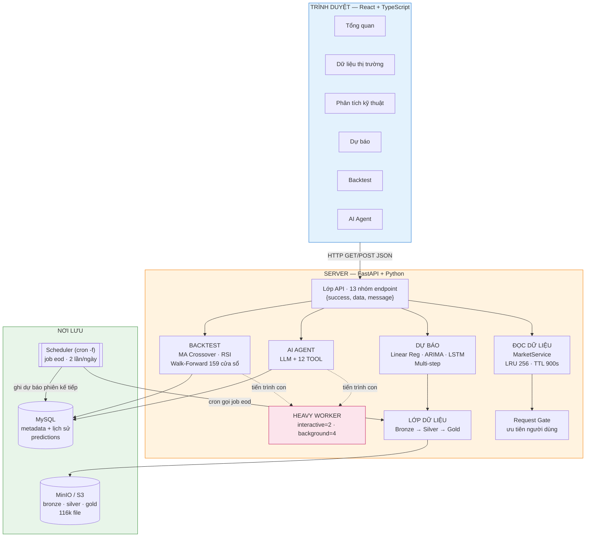

## M2. Luồng dữ liệu 3 tầng

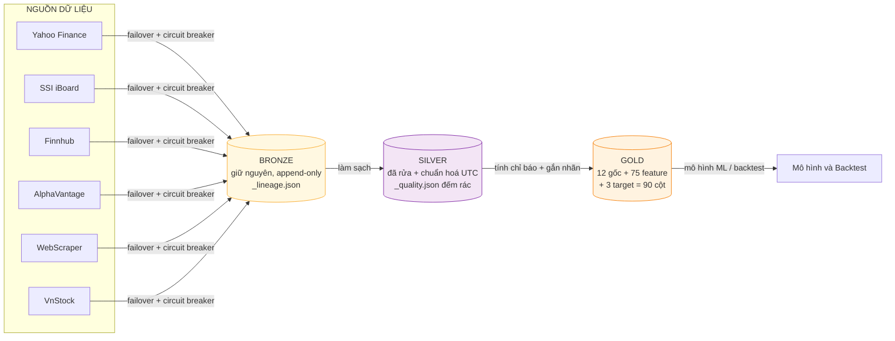

## M3. Chia train / validation / test theo thời gian

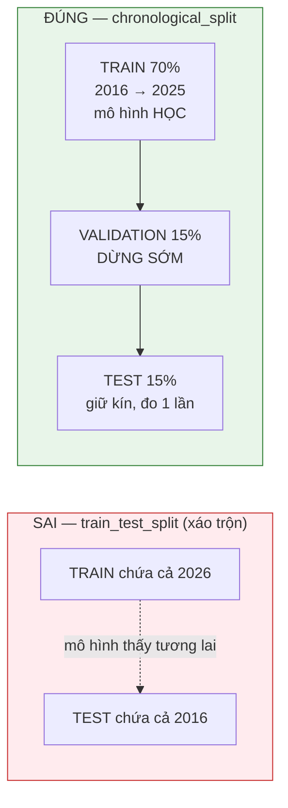

## M4. Tránh nhìn thấy tương lai (look-ahead bias)

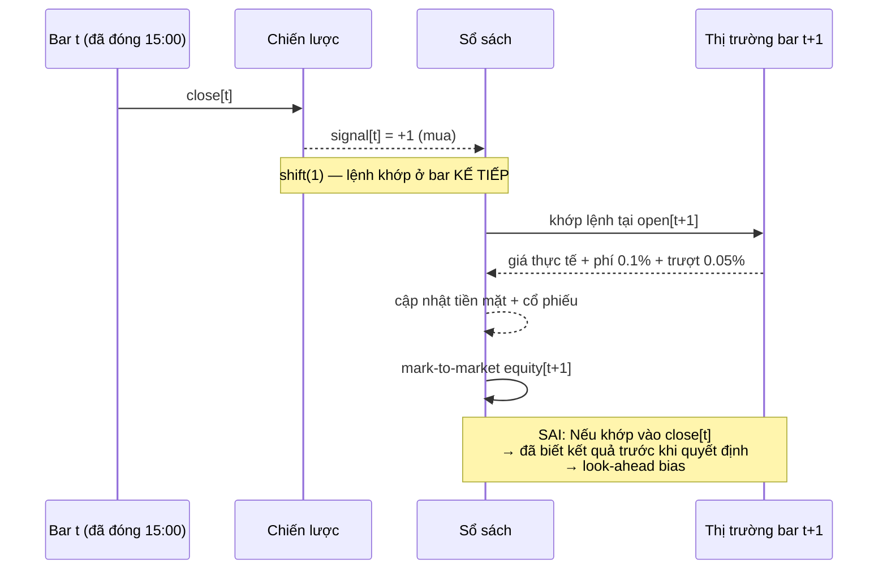

## M5. Walk-forward 159 cửa sổ trượt

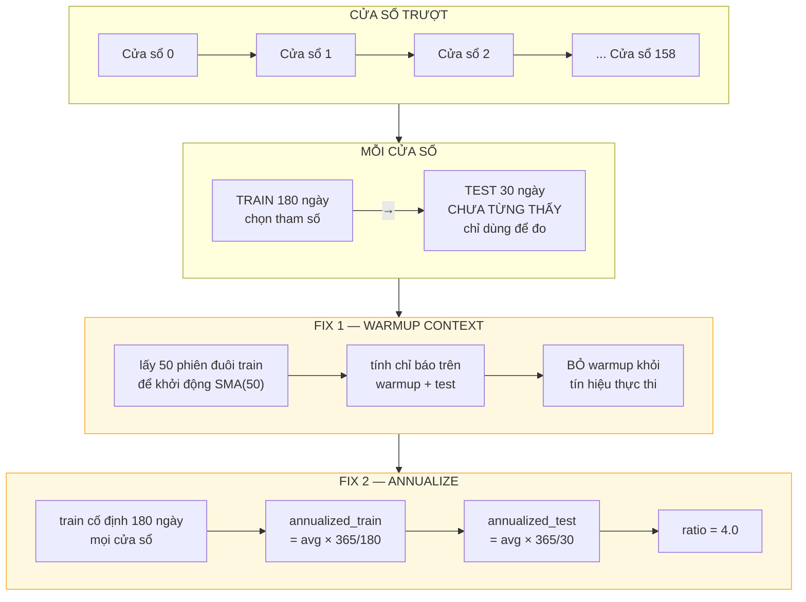

## M6. LSTM — dự đoán tỷ lệ thay vì mức giá

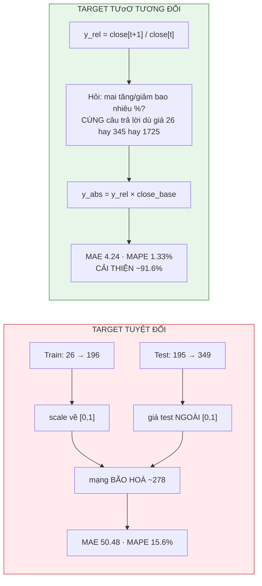

## M7. GIL — Thread vs Process

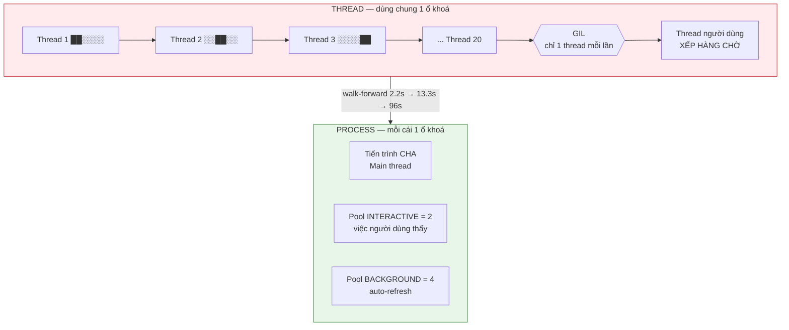

## M8. Request Gate — ưu tiên người dùng

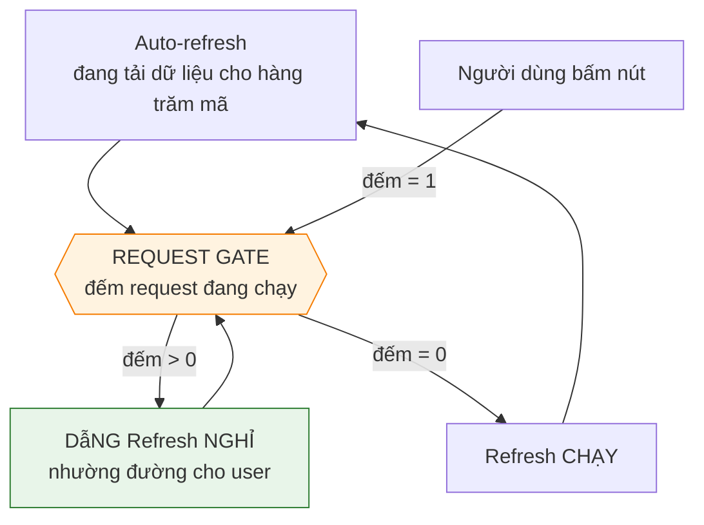

## M9. TanStack Query — đổi mã phải đổi cache

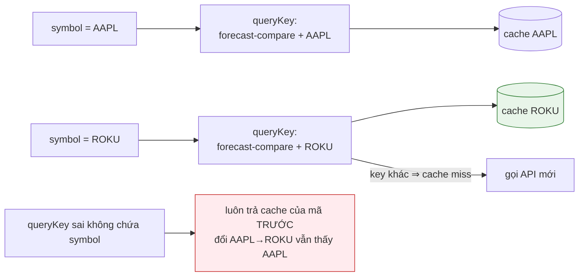

## M10. Chống rò rỉ dữ liệu — bức tường 3 lớp

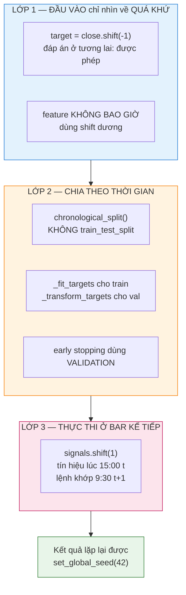

## M11. AI Agent — số đến từ đâu

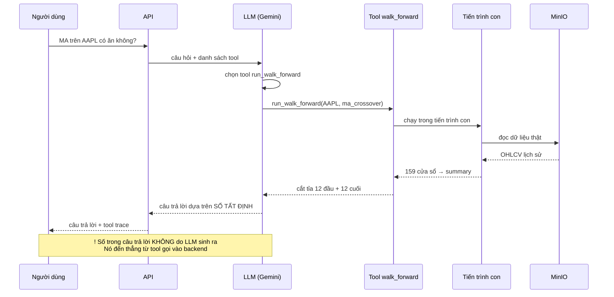

## M12. So sánh 3 mô hình — báo cả 3

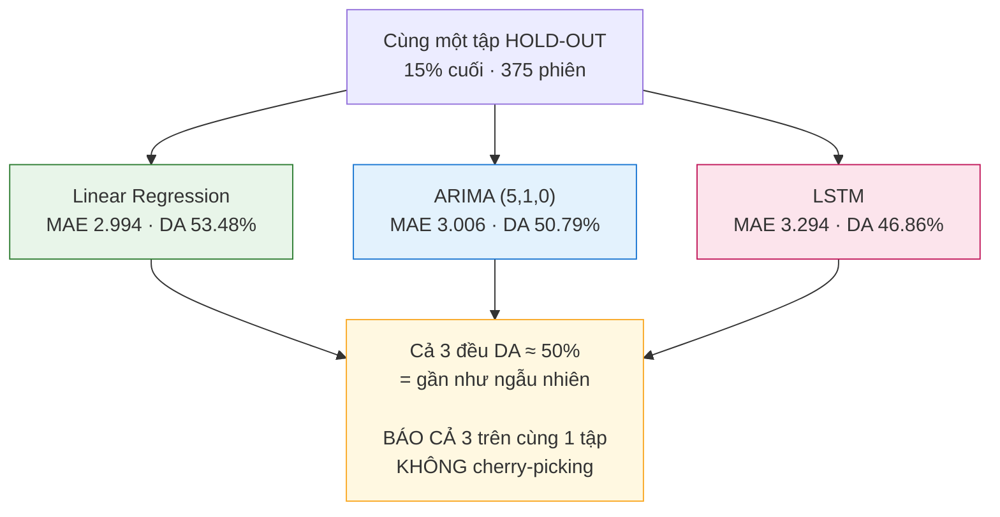

---

<a id="18"></a>
## 18. Đo đa mã — chiến lược vs đường cơ sở mua & giữ

### ① Hình vẽ

```
┌──────────────────────────────────────────────────────────────────────────┐
│  TẦNG BRONZE — 1.002 mã có dữ liệu thật                                  │
│  NYSE 697 · HOSE 81 · TSE 39 · Euronext 31 · XETRA 29 · HKEX 20 ·        │
│  KRX 20 · TWSE 20 · Nasdaq Nordic 19 · TSX 17 · LSE 15 · SIX 5 · BME 4   │
└──────────────────────────────┬───────────────────────────────────────────┘
                               ▼  lấy mẫu 8 mã/sàn (có tầng)
┌──────────────────────────────────────────────────────────────────────────┐
│  101 MÃ · 13 SÀN                                                         │
└──────────────────────────────┬───────────────────────────────────────────┘
                               ▼  walk-forward 365/90/90
┌──────────────────────────────────────────────────────────────────────────┐
│  MỖI CỬA SỔ TEST (3.687 cửa sổ) — CÙNG BỘ PHIÊN                          │
├──────────────────────────────────────────────────────────────────────────┤
│                                                                          │
│    ┌────────────────────────────┐      ┌────────────────────────────┐    │
│    │  CHIẾN LƯỢC               │      │  ĐƯỜNG CƠ SỞ MUA & GIỮ    │      │
│    │  MA Crossover / RSI        │      │  mua đầu kỳ, giữ cuối kỳ  │     │
│    │  phí 0,1% + trượt 0,05%   │      │  phí 0,1% + trượt 0,05%   │      │
│    │  khớp lệnh bar kế tiếp    │      │  khớp lệnh bar kế tiếp    │      │
│    └─────────────┬──────────────┘      └──────────────┬─────────────┘    │
│                  │                                    │                  │
│                  └──────────────┬─────────────────────┘                  │
│                                 ▼                                        │
│                    ┌────────────────────────┐                            │
│                    │  CHÊNH LỆCH TỪNG CỬA SỔ │  (so sánh CẶP)            │
│                    │  chiến lược − mua & giữ  │                          │
│                    └───────────┬────────────┘                            │
│                                ▼                                         │
│    ┌──────────────────────────────────────────────────────────────┐      │
│    │  KẾT QUẢ (Đo ngày 11/11/2026)                                │      │
│    │  Median RR:  MA 0,22% · RSI 0,42% · MUA&GIỮ 2,28%            │      │
│    │  % mã lãi:   MA 60,4% · RSI 70,3% · MUA&GIỮ 91,1%            │      │
│    │  % mã thắng baseline: MA 8,9% · RSI 13,9%                      │    │
│    │  MaxDD median: MA −4,56% · RSI −2,00% · MUA&GIỮ −11,87%       │     │
│    │  → Chiến lược THUA ở cả 13 sàn. Cái được: GIẢM RỦI RO.       │      │
│    └──────────────────────────────────────────────────────────────┘      │
└──────────────────────────────────────────────────────────────────────────┘
```

### ② Đọc hình vẽ bằng lời thường

Hình này kể một câu chuyện có ba đoạn.

**Đoạn 1:** Từ 1.002 mã thực sự có trong kho dữ liệu, ta lấy 101 mã, mỗi sàn lấy 8 mã. Việc chia đều theo sàn là cần thiết: 697 mã là của Mỹ, nếu lấy bừa thì phần "so sánh 13 sàn" sẽ chỉ nói về Mỹ.

**Đoạn 2:** Mỗi mã được chia thành các cửa sổ học 1 năm rồi thi 3 tháng, lặp lại 37 lần. Trong **mỗi** cửa sổ thi, ta chạy **hai** thứ trên **cùng một bộ phiên**: chiến lược, và hành động đơn giản "mua một lần rồi giữ". Hai bên trả cùng mức phí, cùng độ trượt, cùng cách khớp lệnh ở giá mở cửa phiên kế tiếp.

**Đoạn 3:** Lấy hiệu của hai bên theo từng cửa sổ. Đó là con số trung tâm: chiến lược thắng hay thua việc cứ nắm giữ, trên đúng những phiên mà nó được đo.

Kết quả không đẹp: đường cơ sở thắng ở 91,1% số mã, và kết luận **không đổi ở cả 13 sàn**. Nhưng có một điều chiến lược làm được: nó giảm mức lỗ tệ nhất từ −11,87% xuống −2,00% (RSI). Đó là một đánh đổi thật, không phải lỗi kỹ thuật.

### ③ Chi tiết kỹ thuật

- Module đường cơ sở dùng chung: `backend/app/backtesting/benchmark.py`
- Ghi baseline từng cửa sổ + chênh lệch cặp: `backend/app/backtesting/walk_forward.py`
- Script đo: `backend/scripts/run_multi_symbol_walkforward.py`
- Endpoint đọc báo cáo: `backend/app/api/v1/endpoints/backtesting.py` (`GET /api/v1/backtests/multi-symbol-report`)
- Trang web: `frontend/src/pages/Backtesting.tsx` (route `/backtesting`, tab "Walk-forward đa mã")
- Test bất biến: `backend/tests/test_backtest_benchmark.py` (6 test)
- Tài liệu chi tiết: `docs/NGHIEN_CUU_DA_MA_WALK_FORWARD.md`

**Kết quả đo ngày 11/11/2026** — 101 mã, 3.687 cửa sổ kiểm tra, 0 mã lỗi đọc, thời gian 112 s (MA) và 118 s (RSI).

---

# PHỤ LỤC — MẸO ĐỌC SƠ ĐỒ KHI BỊ HỎI

| Câu hỏi thầy hỏi | Sơ đồ nên mở | Câu trả lời |
|---|---|---|
| "Hệ thống bạn tổng thể thế nào?" | [Sơ đồ 1](#1) | "3 khối: trình duyệt → server → nơi lưu. Trình duyệt không tự tính toán." |
| "Dữ liệu đi qua những bước gì?" | [Sơ đồ 2](#2) | "Bronze giữ nguyên → Silver làm sạch + đếm rác → Gold tính chỉ báo + gắn nhãn." |
| "Em có bị nhìn thấy tương lai không?" | [Sơ đồ 4](#4) + [13](#13) | "Không, 3 lớp: shift(-1) cho target, tách theo thời gian, và shift(1) cho lệnh." |
| "Walk-forward hoạt động thế nào?" | [Sơ đồ 5](#5) | "159 cửa sổ trượt, mỗi cửa sổ học 180 ngày rồi thi 30 ngày trên dữ liệu chưa từng thấy." |
| "Em tìm ra lỗi gì?" | [Sơ đồ 6](#6) | "3 bug walk-forward, mỗi cái có số đo trước → sau." |
| "Đóng góp chính của em là gì?" | [Sơ đồ 7](#7) | "LSTM dự đoán tỷ lệ thay vì mức giá: MAE 50.48 → 4.24 (−91.6%)." |
| "Mô hình nào tốt nhất?" | [Sơ đồ 8](#8) | "LR có MAE thấp nhất, nhưng cả 3 đều DA ≈ 50%. Tôi báo cả 3." |
| "Vì sao hệ thống không bị lag?" | [Sơ đồ 9](#9) + [10](#10) | "Process pool để bypass GIL + request gate để refresh nhường người dùng." |
| "AI lấy số ở đâu ra?" | [Sơ đồ 12](#12) | "Số đến từ tool gọi vào backend, LLM chỉ diễn giải." |
| "Chiến lược có ăn không?" | [Sơ đồ 18](#18) | "Không — 101 mã / 13 sàn: đường cơ sở mua & giữ thắng 91,1% số mã. Em báo cáo nguyên vẹn." |
